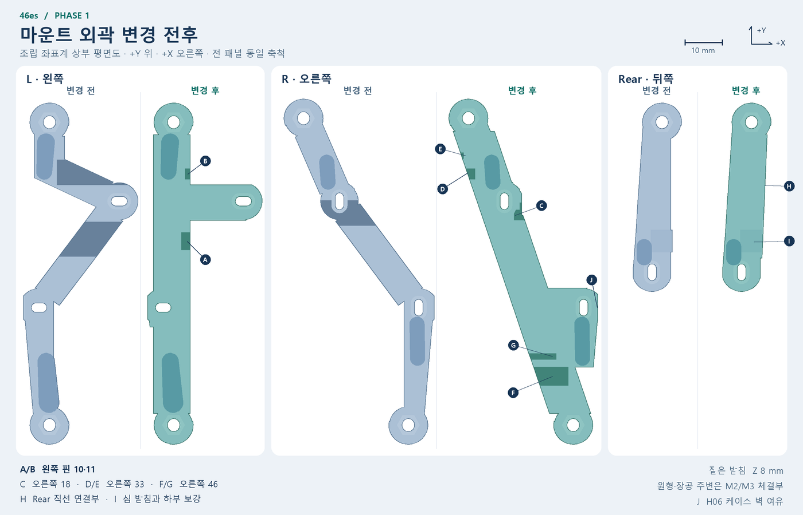

# v5 구조 개선 로드맵 (계획)

제작 조건과 실물 시험은 [검증 목록](validation.md)과 [주문 안내](../model/print_v5/README.md)에서 관리한다.

## 로드맵
1. **Mount 개선** — keyswitch leg/pin 충돌 회피, 불필요 형상 제거, 단순·직선화.
2. **Ctrl bracket 개선** — Pro Micro 브래킷/게이트/체결/배선·USB 간섭을 단순·안정적으로 개선.
3. **Mount + Ctrl/Spine 병합** — 역할/경계 재정의 후 부품 수·체결·조립 복잡도 축소(가능 범위에서).

원칙: 단계별로 분리 검증. 3단계는 1·2단계의 형상/인터페이스가 안정된 뒤 진행.

## 1단계 — Mount 개선

2026-11-09 재구축(`decision:` 커밋). Phase 1(`f41bda4`·`91ec26c`·`9c79cb5`)은 v4 바디 위에 T자 레일·CADCraft clip·fill을 겹치는 패치 방식이었고, 그 결과 오른쪽 윗레일이 도면보다 좁게(10.67 → 9.3–10.4 mm) 남고 Front 아랫변 x≈155에 0.3 mm 슬롯이 재생성될 때마다 생겼다. Rear의 spine 받침(Z 3.95)은 clip에 잘려 3.3이 됐고, 오른쪽 두 번째 plate 받침은 만들어지지 않았다. 현행 구조는 다음과 같다.

- `tools/mounts_v5.py`가 `model/mounts_cadcraft_phase1.dxf`의 외곽(레이어 `0`·`L_OUTLINE`·`R_OUTLINE`·`REAR_OUTLINE`), 받침(레이어 `0` 폐폴리라인·`REAR_PLATE_SEATS`), `REAR_SHIM`을 그대로 돌출한다. 도면이 곧 결과다. 도면 수정은 한 곳이다: Front 윗변(H03 머리 자리 위)을 Y 13.595에서 13.75로 올려 MJF 벽 1.0을 확보했다(옛 생성기는 이 변을 코드에서 0.15 올렸다). 생성기는 포켓·홀과 외곽 사이 벽이 1.0 미만이면 도면 수정을 요구하며 멈춘다.
- SO1–SO6 관통홀·육각 지지대 포켓(AF 5.4, Z 2–3)과 케이스 나사 장공·머리 자리는 문서 매개변수(`TBD_so_*`, `TBD_case_*`, `CAND_H0*`)로 만든다. 도면의 `*_THROUGH_HOLES`·`*_HEAD_RECESSES`는 이 형상과 일치해야 하며 생성에는 쓰지 않는다. AF 8.5 팔각 랜드는 다른 절삭이 들어오지 않는 보존 구역이고, 9c79cb5의 둘레 홈(0.3 mm 링, 우측 1.5 mm 해자)은 폐지했다.
- 핀 회피부는 키 배열과 KS-3X1 핀 위치에서 계산한다(좌 10·11, 우 18·33·46). 도면의 `*_RELIEFS` 레이어는 참고용이다. 머리 자리와 가까운 포켓(우 18)은 1 mm 클로징으로 이어 접선 필렛을 만들고, 몸체에 1 mm 미만으로만 걸치는 핀(우 33)은 둥근 스캘럽으로 판다. 받침과 스위치 몸체가 겹치는 곳(좌 11, 우 46)은 Z 4.95 위만 잘라 프레임을 남긴다. 생성기는 절삭 옆에 1 mm 미만 두께의 재료 조각(칼날·깃털 모서리)이 남으면 위치를 적고 멈춘다.
- 옛 v4 mount 사슬(FRAME·CASE·SO·MASK·MIN_V2·PAIR_V3 등 103 피처)과 참고 전용 `REF_SWITCH_*_BOUND_ASSUMED`·Wilmore 하우징은 생산 모델에서 억제한다. 조립 검토 모델은 하우징 피처를 실측 PSD60 값으로 다시 켠다. 전체 평가는 48 s에서 약 16 s로, `--mounts` 단독 빌드는 약 2 s다.

### 검증

- `build_seam_v5.py --mounts`: 매개변수만 있는 문서에 mount 4개를 만들고 STL 단면(Z 1.0·2.5·3.6·6.0)을 도면 기준 프로파일과 비교한다. `verify_seam_v5.py`는 같은 비교를 주문 1 STL로 수행하고, 팔각 랜드 보존, 육각 포켓 벽(≥ 1.0), 층별 기대 부피, 받침 7곳의 plate 접촉, SO2 체결부 단면을 검사한다.
- `verify_assembly_reference_v5.py`는 마운트 4개를 46키 센터·다리·단자 참고 형상과 3D 비교한다(하한 0.4 mm). 벽 두께는 주문 1 STL 스캔(MJF 1.0)을 따른다. 수치는 [검증 기록](../inspection/data/seam-v5-verification.json)과 [조립 검증 기록](../inspection/data/assembly-reference-v5-verification.json)에 있다.
- 실제 5핀·납땜·배선, Rear 탈착 공간, PSD60 체결, 받침 접촉과 마운트 강성은 [실물 확인 목록](validation.md#실물-확인-목록)에서 관리한다.

## 2단계 — Ctrl bracket 개선

2026-11-09 재설계(`decision:` 커밋). 첫 시도(`7744368`)는 립·스톱·게이트 핑거를 억제해 PCB를 −Z·X로 잡는 형상이 사라졌고, 남은 게이트는 할 일 없이 M2×5·너트만 남겼다. 펌웨어 핀은 양쪽 5–12번 패드(16선)라 긴 변 전체 홈에 밀어 넣는 방식은 납땜·배선과 양립하지 않고, 앞 M2 너트 보스는 배선 5번 패드 위 0.8에 있었다. 현행 구조는 다음과 같다.

- `tools/ctrl_v5.py`가 PCB 기준 좌표에서 브래킷을 만든다. v4 브래킷·게이트 사슬, plate 게이트 홈 2곳, 옛 참조 나사는 생산 모델에서 억제한다. 형상·근거는 [설계 기준](design.md#체결분해)에 있다.
- 고정: +X 끝 립(크리스털 양옆 두 구간)·끝 벽, USB 양옆 모서리 턱, Y로 휘는 탄성 암 2개(립 걸림 0.4). 나사는 브래킷 M2×6 2개만 남는다(게이트 M2×5·너트 1조 감소).
- plate L의 브래킷 나사 구멍을 배선 구역 밖 (121.7, 18.96)·(121.7, 25.16)으로 옮겼다. 앞 이음 쿠폰은 새 구멍이 쿠폰 경계에서 0.04가 되므로 옮기기 전 plate를 복사한다(옛 구멍·게이트 홈만 빠짐).
- 주문 1에 시험편 A·B·C(걸림 0.25 / 0.4 / 0.55, 끝 0.7 / 0.98 / 1.2)를 넣는다.

### 검증

- `ctrl_v5.check()`: 배선 패드(납땜면·부품면), 부품면 부품, 스위치 하우징·핀(1·23번 절단 다리 제외), USB 플러그, mount, plate 16.5 릴리프와 겹치지 않음. 프리즘 두께 ≥ 1.0. 탄성 암 변형률은 외팔보 계산(삽입 1.75 %, 멈춤 1.85 %).
- `build_seam_v5.py`: 브래킷 3개가 각각 닫힌 단일 셸, 부피가 생성기 추정과 1.5 % 이내. `verify_seam_v5.py`: 변경·추가 바디 겹침 0, 브래킷은 plate·너트에만 닿음, plate L 부피 변화 = 게이트 홈(+138.32 mm³), 쿠폰 L 변화 = 옛 구멍·게이트 홈. 주문 1·2 STL 벽 1.00.
- `verify_assembly_reference_v5.py`: 검토 모델의 Pro Micro(부품·패드 위치가 생성기와 일치)와 브래킷 겹침 0, 브래킷 ↔ 스위치·케이스 ≥ 0.3, PCB에 파고드는 스위치 다리는 1·23번 두 개(0.86 mm)뿐.
- 실제 끼움·해제·반복 탈착과 배선 상태 정비성은 [실물 확인 목록](validation.md#실물-확인-목록)의 「컨트롤러 스냅」.

## 3단계 — Mount + Ctrl/Spine 병합 (개요)
- 대상 후보: `MOUNT_*`, `PLATE_SPINE_V1`, ctrl bracket/gate 간 역할 통합.
- 목표: 부품 수/나사/조립 단계 축소, 배선·분해성 유지, plate 이음 지지 기능 보존.
- 제약: plate L/R 분할 구조·dovetail·spine 배선 홈/지지 역할 재검토 필요. 병합 시 body 이름/가이드 단계/출력 파일/검증 스냅샷 영향 큼 → 별도 설계 결정 후 진행.
- 선행: 1·2단계 완료, 간섭·강성·조립성 확인.

## 공통 검증
- CAD: `build_seam_v5.py`(mount만이면 `--mounts` 먼저) → review/export(`--trial`) → `verify_seam_v5.py` → assembly ref/verify → guide. mount/스위치 하부, plate/SO/M3/USB/ctrl 간섭 3D 확인.
- 정적: `python -B 46es/tools/check_repository.py`; stage 후 `update_manifest.py`/`--check`.
- 실물/미실행: `docs/validation.md`에 `미실행`/`실물 확인 대기` 기록. 주문 1 시험물 변경 시 혼용 금지, 해시/manifest 갱신.
