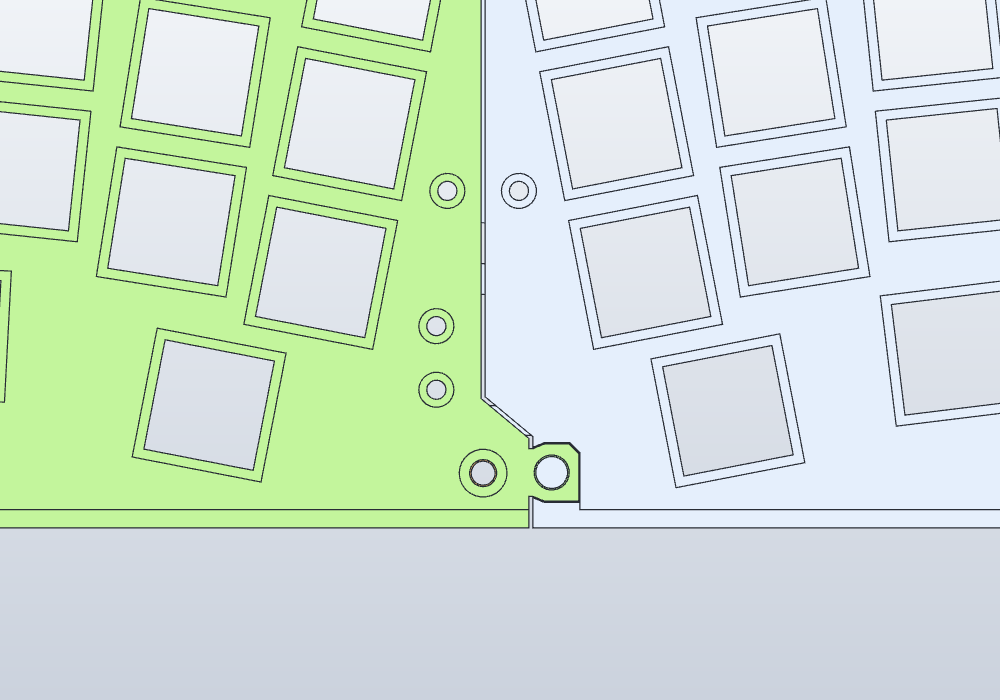
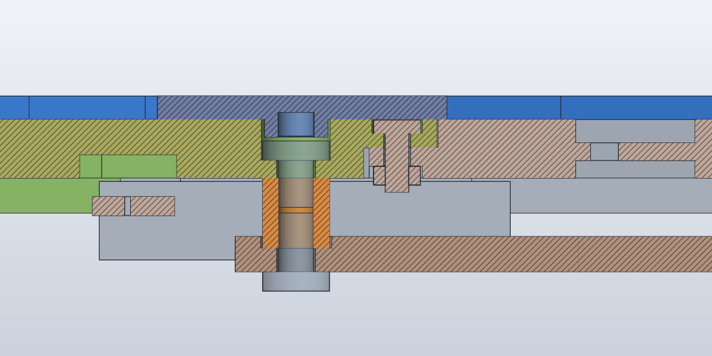

# 46es v4 출력 세트 — 주문 2회

기준일: 2026-11-05(커버 재료는 2026-11-06). 모델은 [`../46es_mount_seam_v4.sc`](../46es_mount_seam_v4.sc), 매개변수는 [`../parameters_seam_v4.csv`](../parameters_seam_v4.csv)다.

**재료는 두 가지다(JLC3DP, 사용자 결정 2026-11-06 "mount, plate는 black으로 하고 cover는 transparent resin으로").**

- **커버 3조각과 보스 탭: 8001 레진, 투명(Transparent).** 업체가 기본으로 사포질과 투명 코팅(oil spraying)을 한다.
- **나머지 전부: MJF PA12S-HP 나일론, 검정.** plate, mount, 그리고 plate에 붙는 spine·브래킷·게이트와 plate 시험물(B 쿠폰, 이음 쿠폰)이다. 2026-11-05에는 MJF PA12-HP 자연 회색이었다.
- FDM용으로 만들었던 세트는 MJF 최소 벽 1.0 기준으로 다시 점검하고 고쳤다. PA12S-HP도 권장 벽이 1.0 초과라 그대로 맞는다. 고친 내용은 아래 "MJF 전환" 절과 [MJF 보고서](../../docs/mjf-pa12-2026-11-05.md)에 있다.
- 재료와 색을 고른 이유는 아래 "재료와 색" 절과 [재료·색 보고서](../../docs/color-material-2026-11-06.md)에 있다.

시험물은 그것이 대신하는 부품과 같은 재료·색으로 뽑는다. 보스 탭은 커버를, B 쿠폰과 이음 쿠폰은 plate를 대신한다.

케이스 구멍 좌표는 **GH60 채택값**(`[GH60 채택 2026-11-05]`)이고 PSD60 실측값이 아니다. 사용자는 정밀 실측 대신 이 값으로 진행하기로 했다(2026-11-05). 오차는 mount 장공(축 ±1.2 / 직교 ±0.2)이 흡수하고, 맞는지는 주문 1에서 확인한다.

plate를 다시 출력하지 않도록 순서를 나눴다. 주문 1의 시험이 통과하면 주문 2를 넣는다.

## 주문 1 — 시험 출력 (`order1/`)

| 파일 | 무엇 | 재료 | 수량 | STL 방향 (참고) | 크기 X×Y×Z mm |
|---|---|---|---:|---|---|
| `46es_v4_sw_hole_coupon` | B 쿠폰: 스위치 홀 13.7–14.3 × 행 A/B/C, M2·M3 구멍, 카운터보어, 육각 포켓 | MJF 검정 | 1 | 홀 면(plate 윗면에 해당)이 아래 | 145.35×74.15×10 |
| `46es_v4_boss_tab` | 커버 보스 + 자석 포켓 탭 (포켓 Ø3.2, 평면 포켓 Ø3.2 / 3.3 / 3.4). 커버의 투명도·표면 견본을 겸한다 | **8001 투명** | 1 | 보스가 위 | 30×30×11.5 |
| `46es_v4_seam_coupon_L` | plate L 앞 이음 부분을 그대로 잘라낸 조각 | MJF 검정 | 1 | plate 윗면이 아래 | 24.90×21.57×8 |
| `46es_v4_seam_coupon_R` | plate R 같은 부분 | MJF 검정 | 1 | plate 윗면이 아래 | 18.87×21.57×8 |
| `46es_v4_mount_L` | 왼쪽 mount (H05/H01 + SO1/SO2) | MJF 검정 | 1 | 밑면이 아래(모델 방향 그대로) | 30.59×91.82×3 |
| `46es_v4_mount_R` | 오른쪽 mount (H06/H04 + SO5/SO4) | MJF 검정 | 1 | 밑면이 아래 | 40.16×92.88×3 |
| `46es_v4_mount_H02_SO3` | 가운데 뒤 mount | MJF 검정 | 1 | 밑면이 아래 | 12.88×50.74×3.95 |
| `46es_v4_mount_H03_SO6` | 가운데 앞 mount | MJF 검정 | 1 | 밑면이 아래 | 69.82×13.08×3 |

견적 화면에서는 파일마다 재료를 따로 고른다. 보스 탭 한 줄만 8001 레진 투명이고, 나머지는 PA12S-HP 검정이다.

**jig A 대신 mount 4개를 넣었다.** mount 4개는 jig A와 같은 것(케이스 구멍 6곳에 나사가 들어가는지)을 실제 부품으로 확인하고, 부피는 jig A의 1/5이다(7.9 cm³ 대 39.2 cm³). 맞으면 그대로 본 조립에 쓰므로 주문 2에서 빠진다. jig A(폭 285.8)는 FDM 한도 250은 넘었지만 MJF 한도 370×276에는 들어간다. 그래도 mount 쪽이 더 많은 것을 확인하므로 jig A는 계속 뽑지 않는다. 모델은 `../jigs/`에 그대로 남겨 두었다.

## 주문 2 — 본 세트 (`order2/`)

| 파일 | 무엇 | 재료 | 수량 | STL 방향 (참고) | 크기 X×Y×Z mm | 부피 cm³ |
|---|---|---|---:|---|---|---:|
| `46es_v4_plate_L` | plate 왼쪽 반 (앞 이음 tab 포함) | MJF 검정 | 1 | 윗면이 아래 | 143.29×95.33×8 | 38.1 |
| `46es_v4_plate_R` | plate 오른쪽 반 (앞 이음 포켓 포함) | MJF 검정 | 1 | 윗면이 아래 | 154.26×95.33×8 | 40.6 |
| `46es_v4_spine` | 이음부 아래 받침(배선 홈 3곳) | MJF 검정 | 1 | 윗면(plate에 닿는 면)이 아래 | 30×49×4.5 | 1.7 |
| `46es_v4_ctrl_bracket` | Pro Micro 브래킷 | MJF 검정 | 1 | 지붕(plate에 닿는 면)이 아래 | 35.68×28.60×7 | 1.4 |
| `46es_v4_ctrl_gate` | Pro Micro 빠짐 방지 게이트 | MJF 검정 | 1 | 너트 포켓 면이 아래 | 7.92×11×7.6 | 0.2 |
| `46es_v4_cover_L` | 커버 왼쪽 (L형) | **8001 투명** | 1 | 윗면이 아래(보스가 위) | 101.88×95.33×3.5 | 5.8 |
| `46es_v4_cover_T` | 커버 가운데 (T형) | **8001 투명** | 1 | 윗면이 아래 | 88.47×95.33×3.5 | 5.2 |
| `46es_v4_cover_R` | 커버 오른쪽 | **8001 투명** | 1 | 윗면이 아래 | 128.79×95.33×3.5 | 6.2 |

주문 1의 mount가 맞지 않아 고쳤다면, 고친 mount를 주문 2에 넣는다.

## 파일 규칙

- **STL 방향은 참고용이다.** FDM용으로 돌려 둔 방향(베드에 닿을 면이 Z = 0, 뒤집은 부품은 X축 180°, `../../tools/orient_print_stl.py --flip`)을 그대로 두었다. MJF는 서포트가 없고 업체가 가루 속에 배치하므로 방향을 지정하지 않아도 된다. 레진 부품(커버, 보스 탭)은 업체가 방향과 받침(서포트)을 정한다.
- 요청할 수 있으면 plate·쿠폰은 **판이 바닥과 나란하게**(스위치 홀이 수평면에) 놓아 달라고 메모에 적는다. Z 방향 공차가 XY보다 조금 느슨하다는 제3자 MJF 자료가 있다.
- 커버 주문 메모: "Top face (flat side without bosses) is cosmetic. Please put supports on the boss side only." 받침은 보스가 있는 아랫면에만 두어 달라는 뜻이다.
- **STEP은 조립 좌표 그대로**다(확인용). 업체에는 STL을 올린다.
- `46es_v4_assembly_REFERENCE.step`은 출력 부품 12개와 지지대·나사·너트·자석 참고 바디를 조립 위치에 둔 확인용 파일이다. 주문하지 않는다. Wilmore 대용 하우징과 스위치 점유 바디는 넣지 않았다.

## 출력 조건 — MJF 부품 (커버·보스 탭 말고 전부)

- 공정·재료: **MJF, PA12S-HP 나일론, 검정**, JLC3DP. 두 주문 모두 같은 재료·같은 색으로 한다. 주문 1의 시험 결과는 같은 재료·같은 색에서만 의미가 있다. 검정은 회색과 치수가 조금 다를 수 있다(한 사용자 시험에서 14.1 각형이 회색 14.0, 검정 14.1). 그래서 B 쿠폰과 이음 쿠폰도 검정으로 뽑는다.
- PA12S-HP는 PA12-HP보다 면이 매끈하고(업체 블로그: 출력 그대로 Ra 6–8 µm 대 10–12 µm), 염색이 고르다. 대신 덜 늘어난다(파단 연신 12 % 대 20 %). 끼움이 빡빡하면 눌러 넣지 말고 줄로 다듬는다.
- 서포트: 없다(MJF).
- 업체 공차: 100 mm 이하 ±0.3, 그 이상 ±0.4 %.
- 최소 벽: 업체 권장 1.0 초과(PA12-HP와 같다. 체결·위치결정 같은 기능부는 1.5 권장). 출력 세트 16개 전체의 벽은 모두 1.0 이상이다(아래 "MJF 전환").
- 크기: 최대 370×276×360, 최소 5×5×5. 모든 부품이 들어간다.
- 끼움 여유: 업체 안내는 조립 부품 0.2–0.4, 움직이는 부품 0.6이다. 앞 이음 tab ↔ 포켓은 0.15로 이보다 작다. 이음 쿠폰으로 확인하고, 빡빡하면 tab 옆면을 줄로 다듬는다.
- 표면: 무광 검정.

## 출력 조건 — 커버 3조각·보스 탭 (8001 레진 투명)

업체 자료([8001 Photosensitive Resin](https://jlc3dp.com/help/article/photosensitive-8001-resin), 2026-11-06 확인):

| 항목 | 값 | 이 세트 |
|---|---|---|
| 공정·색 | SLA 레진. 투명(Transparent)과 반투명(Translucent) 중 **투명**을 고른다 | 투명은 업체가 기본으로 사포질과 투명 코팅(oil spraying)을 한다. 반투명은 받침만 떼고 사포질하지 않는다 |
| 공차 | ±0.2 (100 mm 이내), ±0.3 % (100 mm 초과) | MJF보다 좁다. 커버 R 128.8 기준 ±0.39. 업체 공차는 코팅 전 기준이다 |
| 권장 벽 | 0.8 초과 | 커버 가장 얇은 벽은 보스 둘레 1.09, 나머지 1.6 이상. 보스 탭 1.3. 통과 |
| 크기 | 최소 5×5×5, 최대 780×780×530 | 통과 |
| 기계 성질 | 인장 48 MPa, 파단 연신 12 %, 굽힘 탄성률 2,100 MPa, Shore D 86 | |
| 열변형 온도 | 53 °C | 실내 사용 기준. 실외·고온·강한 햇빛·자외선 환경에는 맞지 않는다(업체) |
| 시작가 | $0.3부터 | 커버 3조각 합 17.2 cm³. 정확한 값은 견적 화면에서 |

- **업체가 밝힌 한계:** 표면 기포·작은 구멍을 완전히 없앨 수 없고, 복잡한 형상은 완전히 투명해지기 어렵다. 커버의 넓은 윗면은 투명하게 나오기 쉽다. 창 안쪽 벽과 보스는 뿌옇게 남을 수 있다.
- **투명이라 아래가 보인다.** 검정 plate 윗면, 앞 이음 선과 M2 머리(커버 T 아래, X 139.5), 보스 안의 자석 6개, 그 밑의 M3 머리가 보인다. 그래서 위 나사는 흑색 합금강으로 사고, 자석은 흑색 에폭시 코팅 제품이 있으면 그것으로 산다(아래 하드웨어).
- **자석은 순간접착제로 붙이지 않는다.** 순간접착제 증기가 투명 레진 표면을 하얗게 흐린다(백화). 투명 2액형 에폭시를 포켓 바닥에 조금만 쓴다.
- 받침 자국은 업체 사포질로 지워지지만, 비쳐 보이는 면이라 보이는 윗면에는 받침을 두지 말라고 메모한다(위 "파일 규칙").
- 투명 레진은 햇빛·자외선을 받으면 누렇게 변할 수 있다(투명 광경화 레진의 일반적 성질). 업체도 자외선 환경을 권하지 않는다.
- 레진은 나일론보다 단단하고 덜 늘어난다. 커버를 벗길 때 창 사이 가는 살(1.6)을 비틀지 않는다(아래 "커버를 벗긴다"는 자석 없는 쪽 끝을 든다).

## 재료와 색 (2026-11-06)

같은 날 결정이 두 번 바뀌었다.

1. 커버만 FDM으로 색·표면을 다르게 하자는 요청 → FDM은 최소 크기 30×30×10에 커버 두께 3.5가 걸리고, 보스 둘레 벽 1.1이 FDM 권장 1.6에 못 미쳐 고르지 않았다.
2. "cover는 black 재료로, 면 품질·비용 우수한 걸로" → JLC Black Resin을 골랐다.
3. **"mount, plate는 black으로 하고 cover는 transparent resin으로 변경"** → 지금 기준이다.

| 부품 | 재료 | 고른 이유 |
|---|---|---|
| plate, mount, spine, 브래킷, 게이트, B 쿠폰, 이음 쿠폰 | **MJF PA12S-HP 검정** | JLC가 PA12S-HP 색으로 검정을 정식으로 내놓는다. PA12-HP보다 면이 매끈하고 염색이 고르며 치수가 안정적이다(업체 블로그). 최소 벽·공차·최대 크기가 PA12-HP와 같아 MJF 수정이 그대로 통한다. spine·브래킷·게이트는 사용자가 따로 말하지 않았지만 plate와 한 묶음이라 같은 재료·색으로 했다 |
| 커버 3조각, 보스 탭 | **8001 레진 투명** | JLC의 투명 재료. 투명 마감(사포질·코팅)이 기본이고, 공차 ±0.2로 좁고, 권장 벽 0.8을 모두 넘는다 |

- 투명 커버가 뿌옇게 나오거나 깨지면, 형상은 그대로 두고 8001 반투명 또는 MJF PA12S-HP로 바꿀 수 있다. 커버는 MJF 최소 벽 1.0도 통과한다.
- 자석은 Ø3×2 그대로다. Ø4로 돌아가면 보스 둘레 벽이 0.6으로 레진 권장 0.8에도 못 미친다.

## 하드웨어 (v4 전체)

| 위치 | 규격 | 수량 | 비고 |
|---|---|---:|---|
| SO1–6 지지대 | M3 암–암 관통, 길이 6, 맞변 AF5 (예: Harwin R30-1000602) | 6 | |
| plate 위 나사 | M3×4 ISO 7380 버튼헤드, **탄소강, 흑색**(흑색 합금강) | 6 (+예비) | 커버 자석이 이 머리에 붙는다. 스테인리스 불가. 투명 커버 아래로 비쳐 보이므로 검정으로 산다. M3×5는 아래 나사와 부딪힌다 |
| mount 아래 나사 | M3×5 ISO 7380 버튼헤드 | 6 | 재질 무관 |
| 커버 자석 | 네오디뮴 원형 **Ø3×2**, N52 (없으면 N35). 흑색 에폭시 코팅 제품이 있으면 그것 | 6 | 쿠폰 시험·예비 포함 20개 묶음 권장. 극성 무관. 투명 커버 보스 안에서 보인다. **MJF 전환으로 Ø4×2에서 바꿨다** |
| bracket·spine | M2×6 저두 (예: NBK SSH-M2-6) | 6 | bracket 2 + spine 4 |
| 게이트 + 앞 이음 | M2×5 저두 (예: NBK SSH-M2-5) | 2 | |
| M2 너트 | DIN 934 M2, 맞변 4, 높이 1.6 | 8 | |
| 케이스 나사 | PSD60 기존 나사 | 6 | r2에서 쓰던 것 |
| 접착제 | 투명 2액형 에폭시 | — | 자석 고정(투명 커버에 순간접착제를 쓰면 하얗게 흐려진다). 이음 접착(선택)에도 쓴다. 아래 "A냐 A+접착이냐" |

주문 1 시험에 필요한 것: M3×4·M3×5 나사와 지지대(B 쿠폰), 자석(보스 탭), M2×5 + 너트 1조(이음 쿠폰), 케이스 나사(mount). 주문 1이 도착하기 전에 하드웨어를 같이 사 두면 기다림이 줄어든다.

자석을 Ø3으로 줄인 이유: 커버 보스(Ø5.4) 끝 포켓에 Ø4 자석이 들어가면 보스 둘레 벽이 0.6이라 MJF 최소 벽 1.0에 못 미친다. Ø3이면 포켓 Ø3.2, 벽 1.1이다. 붙는 힘은 줄지만 커버 조각은 6 g 안팎이라 조각당 2개로 충분하다. 보스 탭으로 확인한다.

## MJF 전환 (2026-11-05)

`../../inspection/scripts/thin_wall_scan.py`로 16개 STL 전체에서 1.0보다 얇은 곳을 찾았다. 면마다 점을 뿌리고, 점에서 재료 안쪽으로 광선을 쏴 반대편으로 나가기까지의 거리를 잰다. 고친 곳:

| 곳 | 전 | 후 | 방법 |
|---|---|---|---|
| **spine 뒤 패드 M2 카운터보어(plate L·R 각 1)** | 윗면에 0.2 막이 남아 **나사머리가 들어갈 수 없었다** | 윗면까지 뚫림 | 카운터보어 돌출 2.6 → 4 (앞쪽 2개와 같게). split v1부터 있던 모델 오류 |
| 앞 이음 너트 포켓 ↔ 이음면 (plate R) | 벽 0.47 | 이음면 쪽으로 열림 | 상자 컷. 너트는 나사와 나머지 다섯 면이 잡는다 |
| 앞 이음 tab 끝 카운터보어 (plate L) | 벽 0.9 | 1.2 | 나사 X 139.8 → 139.5 (`seam_M2_X`) |
| 앞 이음 포켓 ↔ 커버 단차 (plate R, Z 12–13) | 벽 0.92 | 합침 | 상자 컷. 이 부분 tab 맞물림은 Z 10.6–12 (1.4)가 맡는다 |
| SO4 카운터보어 ↔ 뒤 단차 (plate R, Z 12–13) | 벽 0.68 | 합침 | 폭 3.2 상자 컷. 커버 보스는 나머지 둘레와 Z 11.5–12에서 잡힌다 |
| 커버 보스 자석 포켓 둘레 (커버 3조각 × 2) | 벽 0.6 | 1.1 | 자석 Ø4 → Ø3 (`TBD_magnet_D`) |
| 보스 탭 자석 포켓 둘레 | 벽 0.8 | 1.3 | 포켓 Ø4.2 → Ø3.2 (`SMP_mag_D`, `SMP_magf_min`) |
| spine 뒤 패드 오른쪽 너트 포켓 꼭짓점 | 벽 0.46 | 옆으로 열림 | 상자 컷 |
| spine 자리 ↔ 스위치 릴리프 (plate L·R 앞·뒤) | 길이 4.7 / 1.8의 얇은 지느러미(0.06–0.65) | 없앰 | 지느러미만 잘라 릴리프와 합침 |
| H02 mount spine 받침 | 0.28 튀어나온 턱(두께 0.95) | 없앰 | 받침 +X 0.33 잘라냄(spine 줄기 밖) |
| 이음 쿠폰 자른 면 | 자른 선이 구멍을 스쳐 0.03–0.8 조각 | 없음 | 쿠폰 범위 X 118–150, Y −0.4–21.2로 다시 정함 |

남은 1.0 미만 값은 벽이 아니라 **모서리 끝**이다(광선이 모서리 바로 옆에서 시작하면 짧다). 들어가고 나가는 면이 20° 안쪽으로 마주 보는 점만 벽으로 세면 모든 부품이 1.0 이상이다. 남은 모서리: 앞 이음 dovetail 목(68°), 커버 창 모서리, 원과 직선이 만나는 곳, H03 mount 원호 끝의 0.03 계단(모델링 잔여, 출력에 영향 없음). 기록은 `../../inspection/data/seam-v4-mjf-thin-wall.json`.

## 앞 이음 (v4)

v3까지 plate L/R은 가운데(Y 38–87)의 spine으로만 이어져 있었고, 앞쪽(Y 0–38)은 맞대기만 했다. plate R은 지지대가 SO4·SO5(오른쪽 끝) 두 개뿐이라 앞 왼쪽 모서리가 가장 약하다.

- **dovetail 반턱**: plate L 윗면 쪽 2.4 mm(Z 10.6–13)가 이음면 너머로 tab으로 나와, plate R 윗면의 포켓에 위에서 내려 꽂힌다. tab은 이음면에서 6.0 → 안쪽 7.2로 넓어져서 좌우로 빠지지 않는다. 포켓은 tab보다 사방 0.15 크다.
- **M2×5 1개 + 너트**: tab 윗면 카운터보어(Ø4.4×1.2, 중심 X 139.5)에서 plate R 바닥을 지나, R 아랫면 육각 포켓(맞변 4.4×1.0)의 너트로 조인다. 포켓은 이음면 쪽으로 열려 있다. 머리 윗면 Z 12.9로 커버 밑면(Z 13) 아래에 묻힌다.
- **위치**: X 137.1–143.0, Y 3.0–10.2(SO6 바로 오른쪽). 커버 T 조각 아래다. 커버가 투명이라 이음 선과 M2 머리가 비쳐 보인다. 나사는 하나만 들어간다. 이음면에서 커버 창 끝까지 약 6.5 mm뿐이고, 그 뒤(Y 11 이후) 아래에는 컨트롤러 브래킷이 있어 너트를 둘 수 없다.
- 컨트롤러 브래킷 지붕(Y 13–33)이 plate R을 아래에서 받친다. spine(Y 38–87, M2 4개)은 그대로다.
- spine 줄기 아랫면에 **배선 홈** 3곳을 냈다(Y 49 / 64 / 72, 폭 3 × 높이 2). 행 배선이 seam을 건너는 곳이다.
- 뒤쪽(Y 83–95)은 spine 뒤 패드(M2 2개)가 이미 잇고 있어 바꾸지 않았다. 뒤에 나사를 하나 더 넣을 자리는 spine 패드와 너트 포켓이 겹쳐서 없다.

## 주문 1 도착 후 시험

1. **B 쿠폰·보스 탭**: [`../samples/README.md`](../samples/README.md) "출력·시험 절차" 3–9번. 스위치 끼움, 카운터보어·보스, Ø3 자석 포켓(3.2 / 3.3 / 3.4)과 붙는 힘, 육각 포켓, 축척 오차율. 보스 탭(투명 레진)과 B 쿠폰(검정 MJF)의 조합이 실제 커버와 plate의 조합이다. 탭의 투명도, 기포, 받침 자국, 에폭시로 붙인 자석이 어떻게 비쳐 보이는지도 본다.
2. **이음 쿠폰**: L 조각을 R 조각 위에서 내려 tab을 포켓에 꽂는다.
   - 힘 없이 들어가는지 확인한다.
   - 윗면 단차를 손톱으로 확인한다.
   - R 아랫면 포켓에 너트를 넣고 M2×5를 조인다. 포켓은 이음면 쪽으로 열려 있으니 너트가 나사에 물릴 때까지 손가락으로 받친다.
   - 이음 가까이를 눌러 보고, 흔들림과 삐걱임을 기록한다.
   - 빡빡하면 tab 옆면을 줄이나 사포로 조금 다듬는다(plate를 다시 출력하지 않아도 된다). 헐거우면 아래 접착안으로 간다.
3. **mount 4개**: PSD60에 케이스 나사로 고정한다. 장공 안에서 나사가 들어가는지, 지지대가 육각 포켓에 들어가 돌지 않는지 확인한다.
4. 결과를 알려 주면 주문 2 전에 v4 값을 고친다(예: 이음 여유, 홀 크기, 보스 여유, 자석 포켓).

## A냐 A+접착이냐 (가조립 후, 배선 전에 정한다)

형상은 둘 다 같다. 본 plate를 받으면:

1. plate L/R을 위 2번처럼 맞추고 M2로 조인다. spine과 브래킷도 단다.
2. 스위치를 꽂고 가운데 아래쪽 키를 눌러 본다.
3. 이음부에 단차·삐걱임이 있으면 tab 아래와 옆을 사포로 거칠게 하고 탈지한 뒤 2액형 에폭시를 바르고 다시 조인다. 나일론은 매끈하면 잘 붙지 않는다. 핫멜트는 이 겹침 이음에 맞지 않는다.
4. 그다음 배선한다. 배선이 seam을 건너면 그 뒤로는 반쪽을 벌리기 어렵다.

## 재현·검사

- 내보내기: SolidCraft에서 v4를 열고 바디별로 STL/STEP을 내보낸 뒤 `python -I ../../tools/orient_print_stl.py IN.stl OUT.stl [--flip]`. 보스 탭과 B 쿠폰은 `../samples/46es_sw_hole_sample.sc`에서 내보낸다.
- 얇은 벽: `python -I 46es/inspection/scripts/thin_wall_scan.py --map 46es/inspection/data/seam-v4-print-set.json EVAL.json --json OUT.json 46es/model/print_v4/order*/*.stl` (`EVAL.json`은 `solidcraft-cli eval --json-out`).
- 검사: `python -B 46es/inspection/scripts/verify_seam_v4.py`. 확인하는 것:
  - v3 파일이 그대로인지, v4·MJF에서 손대지 않은 92바디의 BRep이 v3와 같은지
  - CSV 195행, 상태(111바디·타임라인 428·64스케치 dof 0·오류 0), 간섭
  - STL 16개(성분 1, 비정상 모서리 0, 부피 차 0.03 % 이내)
  - 얇은 벽 기록이 지금 STL의 것인지, 모든 벽이 1.0 이상인지
- 수치 기록: `../../inspection/data/seam-v4-print-set.json`, `seam-v4-health.json`, `seam-v4-clearance.json`, `seam-v4-mjf-thin-wall.json`.
