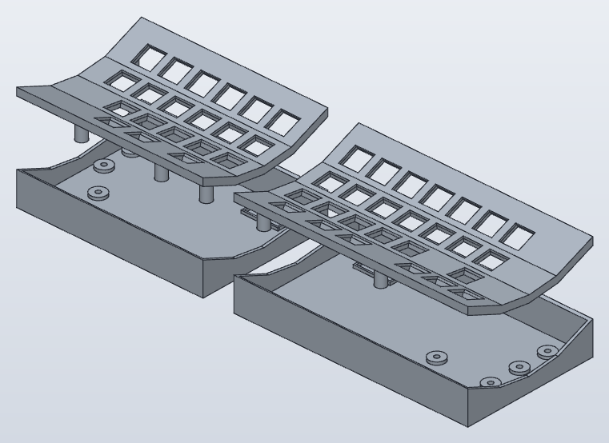
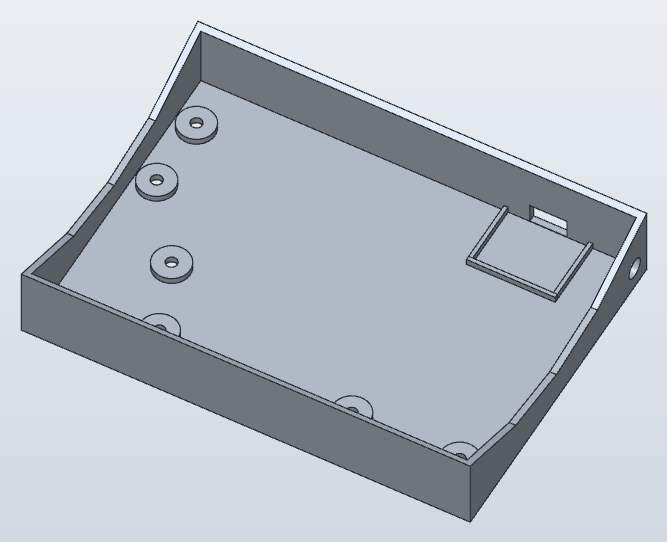
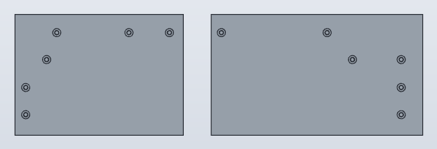

# 46sp 조립 가이드 (MJF 출력판)

2026-11-12 기준. [46sp-print.sc](model/46sp-print.sc)(생성기 [build_print.py](tools/build_print.py))와 [46sp 펌웨어](firmware/46sp/)를 따른다. 설계 기준과 결정 경위는 [README](README.md), 남은 작업은 [TODO](TODO.md)에 있다.

## 이 가이드의 상태

조립 순서, 체결 방식, 배선표와 플래시 절차는 정해져 있다. 실측이나 출력 시험을 거쳐야 하는 값은 **[확인 필요]**로 표시했다. 그런 값이 바뀌면 출력 모델만 바뀌고 이 순서는 그대로다.

| 항목 | 상태 |
|---|---|
| 부품 구성, 체결(인서트 + 밑에서 M3×10), 조립 순서 | 정해짐 |
| 키 배열 46키, 매트릭스 배선표, 컨트롤러 핀 | 정해짐(펌웨어와 같다) |
| 전체 기울기·높이(`TILT_DEG` 0°, plate 밑면 최저 Z 10) | **[확인 필요]** 실물 조립체 측정 대기 |
| 오른쪽 폭, 오른쪽 1·2행 7번째 열 위치 | **[확인 필요]** 실물 케이스 검토 대기 |
| AUX 잭 구멍(Ø6.2)과 위치, RP2040-Zero 받침, USB 개구 | **[확인 필요]** 공칭 치수로 모델링, 실물 측정 대기 |
| 스위치 구멍 14.0, 인서트 구멍 Ø4.2 | 46es 쿠폰 값. MJF 출력품에서 **[확인 필요]** |
| AUX 잭의 팁·링·슬리브 ↔ GND·5 V·GP0 | **[확인 필요]** 실물 연속성 측정으로 정한다 |
| 46키 펌웨어 | 컴파일 전(이 PC에 QMK 없음) |

## 1. 부품과 공구

| 부품 | 왼쪽 | 오른쪽 | 비고 |
|---|---:|---:|---|
| plate(`Plate_L`·`Plate_R`), MJF 검정 | 1 | 1 | 굽은 5 mm 판, 밑에 다리 6개 |
| case(`Case_L`·`Case_R`), MJF 검정 | 1 | 1 | 벽·바닥 2 mm 트레이 |
| 원형 황동 M3 인서트 Ø5 × 4(보유) | 6 | 6 | 14개 중 12개, 2개 예비 |
| 흑색 M3×10 둥근머리 육각 볼트(보유) | 6 | 6 | 밑에서 조임 |
| MX 스위치 | 20 | 26 | 기존 판에서 이식, 부족분 구매 |
| 다이오드 1N4148 | 20 | 26 | 키마다 1개 |
| RP2040-Zero | 1 | 1 | |
| AUX 3.5 mm 패널 잭(보유) | 1 | 1 | 좌우 케이블 1개(보유) |
| 범폰(보유) | 4 | 4 | |
| 키캡 | 20 | 26 | |

그 밖에 데이터 전송용 USB-C 케이블, 열 배선용 피복 전선, 절연 튜브나 캡톤 테이프, 절연 양면테이프가 필요하다. 공구는 인두(인서트 압입용 팁을 따로 두면 좋다), 땜납, 멀티미터, 와이어 스트리퍼, 2 mm 육각 렌치, 핀셋이다.

## 2. 출력품 받으면 먼저 볼 것

1. plate를 case에 얹어 본다. plate 밑면이 벽 윗면 곡선에 고르게 닿아야 한다. 다리 끝과 바닥 패드 사이는 설계상 0.2 mm 뜬다. 다리가 먼저 닿아 plate가 뜨면 휨이나 수축이다.
2. 스위치 하나를 구멍마다 끼웠다 뺀다. 걸쇠가 '딸깍' 걸리고 흔들림이 없어야 한다. 빡빡하면 바늘줄로 다듬는다. **인서트 구멍은 다듬지 않는다**(열압입 물림이 줄어든다).
3. 케이스 안쪽 벽의 AUX 잭 구멍에 잭을, 받침에 RP2040-Zero를 대 본다. 맞지 않으면 모델의 `JACK_D`·`MCU_*` 값을 고쳐 재출력 대상에 올린다. **[확인 필요]**

## 3. 인서트 열압입 (plate 다리 12곳)

스위치를 끼우기 전에 한다. 인두 열이 스위치에 닿지 않게 하기 위해서다.

1. plate를 뒤집어 다리가 위를 보게 놓는다. 굽은 판이라 흔들리므로 천이나 스펀지로 받친다.
2. 다리 끝의 Ø4.2 구멍에 인서트를 올리고 인두 팁으로 수직으로 누른다.
3. 인서트 끝이 다리 끝면과 같아지면 멈추고, 식을 때까지 누른 채 둔다. 구멍 깊이는 5 mm, 인서트는 4 mm라 밀려난 수지는 안쪽 1 mm 여유로 간다.
4. 기울어 들어간 인서트는 바로잡을 수 없다. 그 plate는 재출력해야 하므로 처음 한두 개는 천천히 한다.

## 4. 스위치 장착

1. plate를 바로 놓고 위에서 스위치를 끼운다. 핀 방향은 모두 같게 한다.
2. 왼쪽 3행 바깥 자리는 구멍이 없다. 오른쪽은 1·2행이 7키, 4행 면에 엄지 3키와 크로스 왼·아래·오른, 3행 면 끝에 크로스 위 키가 있다.
3. 행이 꺾이는 면마다 스위치가 바로 섰는지 옆에서 본다.

## 5. 매트릭스 배선

`COL2ROW`다. **열 선 → 스위치 → 다이오드 → 행 선** 순서로 잇고, 다이오드 띠(캐소드)가 행 선 쪽을 향한다. 행 선은 각 행의 다이오드 다리를 이어 만들면 한 면 안에서 끝난다. 열 선은 행이 꺾이는 곳을 지나므로 피복 전선을 쓰고 여유를 둔다.

위에서 본 배치(키 이름은 BASE 레이어):

**왼쪽** — 바깥 열이 C0

| | C0 | C1 | C2 | C3 | C4 | C5 |
|---|---|---|---|---|---|---|
| R0 | Esc | Q | W | E | R | T |
| R1 | Tab | A | S | D | F | G |
| R2 | (없음) | Z | X | C | V | B |
| R3 | LCtl | LGui | Spc/NUM | | | |

**오른쪽** — 안쪽 열이 C0

| | C0 | C1 | C2 | C3 | C4 | C5 | C6 |
|---|---|---|---|---|---|---|---|
| R0 | Y | U | I | O | P | Bspc | PgUp |
| R1 | H | J | K | L | ; | ' | PgDn |
| R2 | N | M | , | . | / | | |
| R3 | Spc/SYM | RAlt | FN | ← | ↑ | ↓ | → |

- 오른쪽 R3의 C3–C6은 크로스 키다. ↑는 3행 면에 있지만 R3 선에 단다.
- 같은 열 번호의 키는 행이 달라도 한 열 선에 묶는다. 예를 들어 왼쪽 C0은 Esc·Tab·LCtl, 오른쪽 C4는 P·;·/·↑다.
- 밑면에서 작업할 때 plate를 **앞 가장자리를 위로 넘기듯** 뒤집으면 좌우는 그대로이고 앞뒤만 바뀐다. 그러면 위 표의 열 순서를 그대로 쓰고, R3(엄지)이 먼 쪽, R0이 가까운 쪽에 온다.
- 펌웨어의 오른쪽 행 4–7은 이 표의 오른쪽 R0–R3이다.

## 6. 컨트롤러와 AUX 잭

RP2040-Zero 핀(좌우 같음):

| 신호 | 핀 |
|---|---|
| R0, R1, R2, R3 | GP1, GP2, GP3, GP4 |
| C0, C1, C2, C3, C4, C5, C6 | GP5, GP6, GP7, GP8, GP9, GP10, GP11 |
| 좌우 시리얼 | GP0 |
| 전원 | 5V, GND |

1. 보드를 처음 쓰기 전에 BOOT를 누른 채 USB를 꽂아 `RPI-RP2` 드라이브가 뜨는지 본다. 고장 보드를 납땜 전에 거른다.
2. 보드는 부품면을 위로, USB-C를 뒤 벽 개구 쪽으로 해서 받침 안에 절연 양면테이프로 붙인다. 고정 방식은 실물 확인 후 정한다. **[확인 필요]**
3. AUX 잭은 case 안쪽 벽(왼쪽은 오른쪽 벽, 오른쪽은 왼쪽 벽) 뒤쪽 구멍에 안에서 끼우고 밖에서 너트로 조인다.
4. 잭과 보드를 GND–GND, 5V–5V, GP0–GP0으로 잇는다. 잭의 어느 단자를 어느 신호에 쓸지는 케이블 연속성을 재서 정하고 좌우를 같게 한다. **[확인 필요]** 플러그를 꽂는 동안 접점이 스치므로 슬리브를 GND로 두는 것을 권한다.
5. 행 4선, 열 7선을 plate에서 보드로 잇는다. plate를 들어 case 옆에 뒤집어 놓을 수 있을 만큼 선 길이에 여유를 둔다. 보드가 case에 붙어 있으므로 정비 때 이 여유로 plate를 들어낸다.

## 7. 첫 플래시와 단독 시험 (case를 닫기 전)

1. 전원 전에 멀티미터로 각 반쪽의 5V–GND 단락이 없는지, AUX 케이블의 핀별 연속성을 본다.
2. QMK 체크아웃의 `keyboards/46sp/`에 [firmware/46sp/](firmware/46sp/)를 복사하고 `qmk compile -kb 46sp -km default`로 빌드한다.
3. **좌우 케이블을 뺀 상태에서** 보드마다 BOOT를 누른 채 USB를 꽂고 `RPI-RP2`에 같은 `46sp_default.uf2`를 복사한다. 좌우 5 V가 이어지므로 PC에는 한 보드만 꽂는다.
4. 왼쪽만 USB에 꽂고 20키를 하나씩 눌러 위치·키 코드를 확인한다. 안 눌리는 키는 다이오드 방향과 그 행·열 선을 본다.
5. 오른쪽 입력은 왼쪽을 거쳐야 확인할 수 있다. USB를 뺀 채 좌우 케이블을 꽂고, 왼쪽 USB를 다시 꽂아 오른쪽 26키를 확인한다. 핸드니스 설정이 없어 USB를 꽂은 쪽이 왼쪽으로 동작한다(QMK 기본값). 그래서 오른쪽만 PC에 꽂으면 왼쪽 키맵이 나온다.

## 8. case 닫기

1. 선이 다리·벽 윗면에 끼지 않게 정리하고 plate를 case에 내린다. 다리가 바닥 패드 위에 오면 plate가 벽 윗면 곡선에 앉는다.
2. case를 앞뒤로 뒤집어 들고, 밑면 카운터보어 6곳에 M3×10을 넣어 인서트에 건다. 모두 살짝 건 뒤 대각선 순서로 조인다.
3. 다리 끝과 패드 사이 0.2 mm는 나사가 plate를 벽에 당겨 붙이는 여유다. plate가 벽에 닿으면 멈춘다. 더 조이면 plate가 휘거나 인서트가 빠진다.
4. 범폰을 밑면 네 모서리에 붙인다. 카운터보어는 덮지 않는다.

## 9. 양손 시험

USB를 뺀 상태에서 좌우 케이블을 꽂고 왼쪽 USB를 꽂는다. 46키 전부, 네 레이어(BASE·NUM·SYM·FN), 탭·홀드 키(Z/Sft, X/Alt, //Sft, Spc/NUM, Spc/SYM)를 확인하고, 양손 동시 입력과 USB 재연결 후 복구를 본다. 결과는 TODO 6장에 적는다.

## 10. 정비

- 분해: USB와 좌우 케이블을 뺀 뒤 밑면 M3×10 6개를 풀고 plate를 들어 case 옆에 뒤집어 놓는다.
- 좌우 케이블은 언제나 USB 전원을 뺀 상태에서 꽂고 뺀다.
- 왼쪽 재플래시: 양쪽을 연결한 채 FN(오른쪽 엄지)+Y로 `QK_BOOT`를 보내면 왼쪽 보드가 `RPI-RP2`로 뜬다. case를 열 필요가 없다.
- 오른쪽 재플래시: 오른쪽만 꽂으면 왼쪽 키맵으로 동작해 같은 키 조합이 듣지 않는다. case를 열고 BOOT 버튼을 쓴다.
