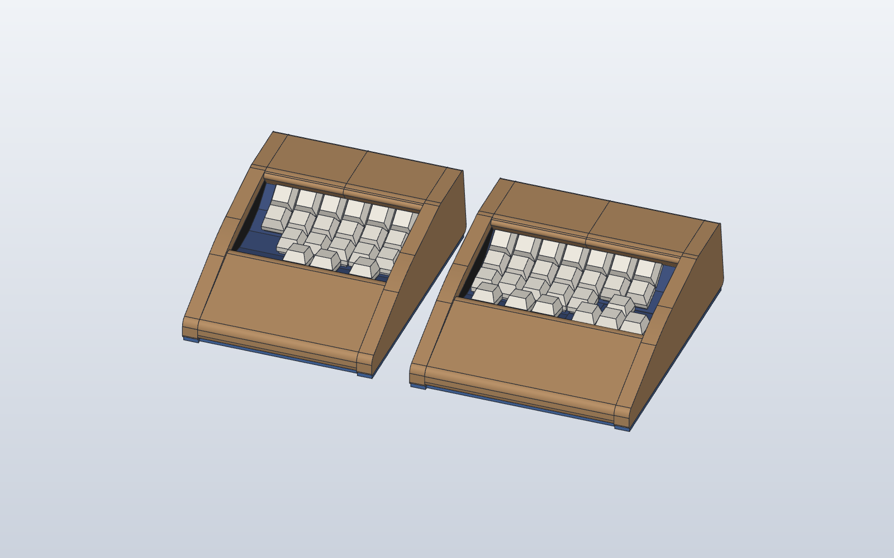
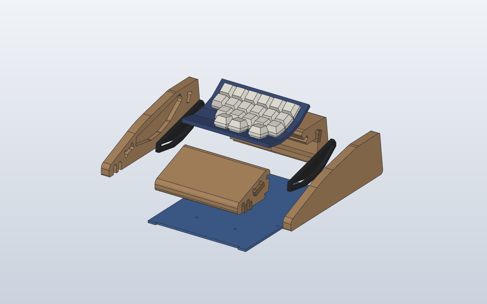
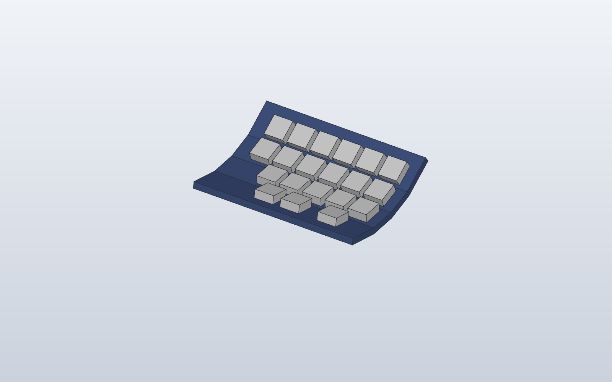
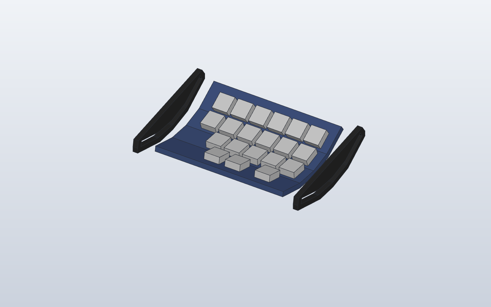
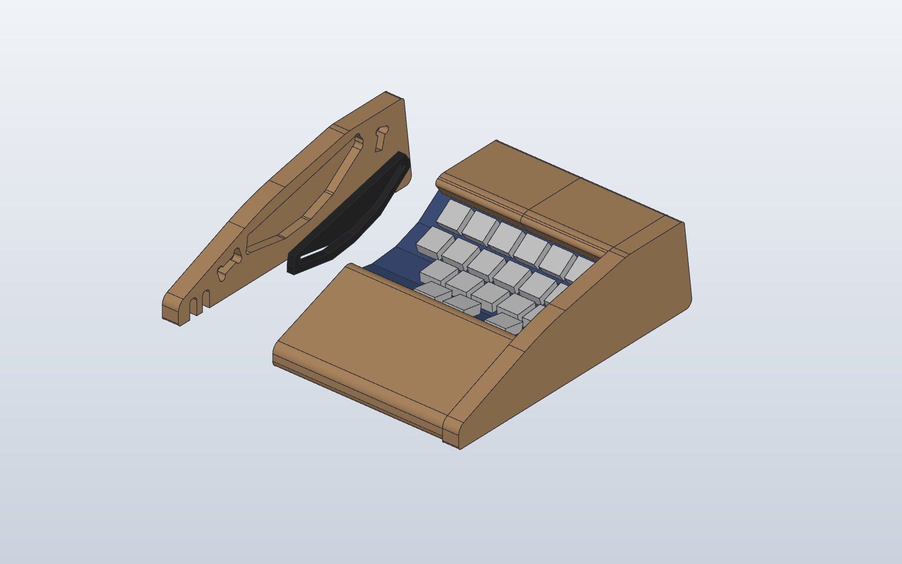
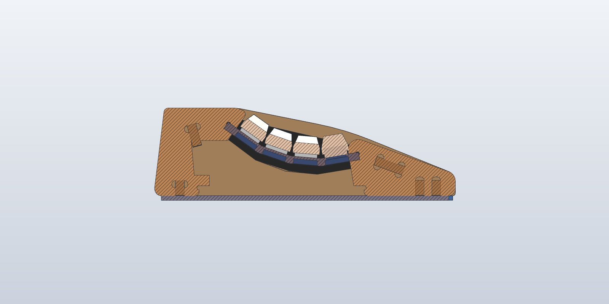
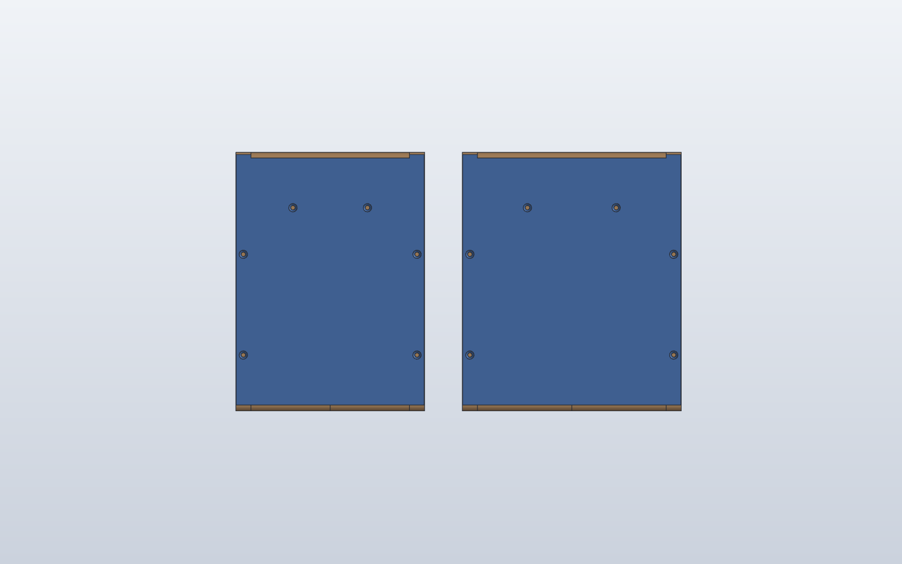

# 46sp 조립 가이드 (기존 합판 case + 출력 plate)

2026-11-13 기준이다. 조립된 합판 case와 r3 아크릴 측판을 그대로 쓰고, plate와 bottom cover만 출력(MJF)해 바꿔 넣는다. 출력 부품은 [46sp-plate-cover.sc](model/46sp-plate-cover.sc)(생성기 [build_plate_cover.py](tools/build_plate_cover.py)), 그림의 조립체는 [46sp-assembly.sc](model/46sp-assembly.sc)(생성기 [build_assembly.py](tools/build_assembly.py))다. 펌웨어는 [firmware/46sp/](firmware/46sp/), 설계 근거는 [README](README.md#출력-plate와-bottom-cover-기존-case-재사용), 남은 일은 [TODO](TODO.md)에 있다.



## 이 가이드의 상태

| 항목 | 상태 |
|---|---|
| 부품 구성, 조립 순서, 체결(측판 끼움 · 측벽 끼움 후 목공풀 · cover 목재 나사) | 정해짐 |
| 46키 배열, 매트릭스 배선표, 컨트롤러 핀 | 정해짐(펌웨어와 같다) |
| plate 끝 혀(5.0)와 측판 홈(5.5), 스위치 구멍 14.0의 MJF 끼움 | **[확인 필요]** 첫 출력에서 본다 |
| 측벽 측판 자리 깊이 | **[확인 필요]** 5T 측판의 안쪽 면이 블록 면과 같아야 한다. STEP의 자리는 옛 4 mm 측판용이다 |
| 엄지 행 키캡을 끝까지 눌렀을 때 앞 블록 안쪽 윗모서리와의 간격 | **[확인 필요]** 모델에서는 0.4 mm 겹친다. 오른쪽 ↓ 키는 1.8 mm다(오른쪽 블록은 왼쪽을 늘린 가정이다). 지금 조립된 키보드에서 엄지 키를 끝까지 눌러 보면 바로 알 수 있다 |
| 컨트롤러 고정 위치와 방식, AUX 잭 단자 ↔ GND·5 V·D2 | **[확인 필요]** |
| 46키 펌웨어 | 컴파일 전(이 PC에 QMK가 없다) |

## 1. 부품과 공구



| 부품 | 왼쪽 | 오른쪽 | 비고 |
|---|---:|---:|---|
| plate(`46sp_Plate_L/R.stl`), MJF 검정 | 1 | 1 | 5 mm 굽은 판. 양 끝 혀가 측판 홈에 들어간다. 오른쪽 3행 높이 ↑ 키 바깥쪽에 로고 `kb46sp/26` |
| bottom cover(`46sp_Cover_L/R.stl`), MJF 검정 | 1 | 1 | 3 mm 평판, 접시머리 구멍 6개 |
| 합판 case(측벽 2, 앞 블록, 뒤 블록 2, bone 막대 5) | 1벌 | 1벌 | 기존 것. 오른쪽은 안쪽 폭 158(왼쪽 134) |
| 아크릴 측판 5T(r3 DWG `229E`·`22A1`·`22B6`·`22B8`) | 2 | 2 | 기존 것. 오른쪽 바깥 측판(`22B6`)만 홈 모양이 다르다(엄지 15° 평면) |
| MX 스위치 | 20 | 26 | 기존 아크릴 판에서 옮긴다(45개). 1개 이상 더 필요 |
| 다이오드 1N4148 | 20 | 26 | 키마다 1개 |
| Pro Micro(ATmega32U4, USB-C, 보유) | 1 | 1 | |
| AUX 3.5 mm 패널 잭(보유) | 1 | 1 | 좌우 케이블 1개(보유) |
| 접시머리 목재 나사 3 × 12 | 6 | 6 | cover 3 mm + 나무 9 mm |
| 고무발 | 4 | 4 | cover 밑, 나사 머리를 덮지 않게 |
| 키캡 | 20 | 26 | |

쓰지 않는 것: 기존 아크릴 plate 9장, 리브 11장(1.5T). 공구는 인두와 땜납, 멀티미터, 와이어 스트리퍼, 핀셋, 십자 드라이버, Ø2 드릴(나사 밑구멍), 목공풀이 필요하다.

## 2. 출력품 받으면 먼저 볼 것

1. 측판 하나를 plate 끝에 끼워 본다. 혀(두께 5.0)가 홈(5.5)에 손으로 밀려 들어가고 흔들림이 적어야 한다. 빡빡하면 혀의 윗면을 사포로 다듬는다. 혀의 밑면은 키 높이를 정하므로 다듬지 않는다. **[확인 필요]**
2. 스위치 하나를 구멍마다 끼웠다 뺀다. 걸쇠가 '딸깍' 걸리고 흔들림이 없어야 한다. 빡빡하면 바늘줄로 다듬는다.
3. 로고 홈에 가루가 남아 있으면 솔로 턴다.
4. cover를 case 바닥에 대 보고 외곽이 바닥면을 따라가는지, 접시머리 구멍이 측벽과 앞 블록 위에 오는지 본다.

## 3. 기존 조립체 분해

case는 CNC 적층 합판이고 측벽이 끼움 결합이라, 측벽을 X 방향(옆으로)으로 빼면 열린다.

1. 키캡을 모두 뽑는다. 배선이 있으면 사진을 찍어 둔다.
2. 측벽 한 장을 옆으로 뺀다. bone 막대는 블록에 남는다. 측판과 아크릴 행 판 묶음이 측벽 자리에서 빠진다. 반대쪽 측벽에서도 묶음을 빼낸다.
3. 아크릴 판에서 스위치를 뺀다. 이미 납땜돼 있으면 배선을 먼저 푼다.
4. 측판을 아크릴 판에서 빼낸다. 측판 4장은 다시 쓰므로 홈 가장자리가 깨지지 않게 다룬다. 측판마다 위치(왼쪽 바깥·안쪽, 오른쪽 바깥·안쪽)를 표시해 둔다.

## 4. 스위치 장착



1. plate를 바로 놓고 위에서 스위치를 끼운다. 핀 방향은 모두 같게 한다.
2. 왼쪽은 3행 바깥 자리에 구멍이 없다(키를 뺀 자리). 오른쪽은 1·2행이 7키다. 바깥쪽 끝에는 엄지 평면(15°)이 있다. 그 위에 크로스 ↑ 키가 3행 높이에, ← ↓ → 키가 4행 높이에 있다.
3. 행이 꺾이는 곳마다 스위치가 바로 섰는지 옆에서 본다.

## 5. 매트릭스 배선

`COL2ROW`다. **열 선 → 스위치 → 다이오드 → 행 선** 순서로 잇고, 다이오드 띠(캐소드)가 행 선 쪽을 향한다. 행 선은 각 행의 다이오드 다리를 이어 만들면 한 면 안에서 끝난다. 열 선은 행이 꺾이는 곳을 지나므로 피복 전선을 쓰고 여유를 둔다. 배선은 plate를 case에 넣기 전에 밑면에서 한다. case를 닫은 뒤에도 cover를 열면 밑에서 손이 닿는다.

위에서 본 배치(키 이름은 BASE 레이어):

**왼쪽** — 바깥 열이 C0

| | C0 | C1 | C2 | C3 | C4 | C5 |
|---|---|---|---|---|---|---|
| R0 | Esc | Q | W | E | R | T |
| R1 | Tab | A | S | D | F | G |
| R2 | (없음) | Z | X | C | V | B |
| R3 | LCtl | LGui | Spc/NUM | | | |

**오른쪽** — 안쪽 열이 C0

| | C0 | C1 | C2 | C3 | C4 | C5 | C6 |
|---|---|---|---|---|---|---|---|
| R0 | Y | U | I | O | P | Bspc | PgUp |
| R1 | H | J | K | L | ; | ' | PgDn |
| R2 | N | M | , | . | / | | |
| R3 | Spc/SYM | RAlt | FN | ← | ↑ | ↓ | → |

- 오른쪽 R3의 C3–C6은 크로스 키다. ↑는 3행 높이에 있지만 R3 선에 단다.
- 같은 열 번호의 키는 행이 달라도 한 열 선에 묶는다. 예를 들어 왼쪽 C0은 Esc·Tab·LCtl, 오른쪽 C4는 P·;·/·↑다.
- 밑면에서 작업할 때 plate를 **앞 가장자리를 위로 넘기듯** 뒤집으면 좌우는 그대로이고 앞뒤만 바뀐다. 그러면 위 표의 열 순서를 그대로 쓰고, R3(엄지)이 먼 쪽, R0이 가까운 쪽에 온다.
- 펌웨어의 오른쪽 행 4–7은 이 표의 오른쪽 R0–R3이다.
- 행 4선, 열 6·7선을 컨트롤러까지 갈 길이로 남겨 둔다(왼쪽은 뒤쪽 안쪽, 오른쪽은 컨트롤러를 둘 자리까지).

## 6. 측판 끼우기



1. 측판을 plate 끝에 옆에서 밀어 넣는다. 4행 측판은 왼쪽 두 장과 오른쪽 안쪽 한 장이다. 오른쪽 바깥(크로스 키 쪽)은 엄지 평면 홈이 있는 `22B6`이다.
2. plate 끝면이 측판 바깥 면보다 튀어나오지 않아야 한다. 튀어나오면 측벽 자리 바닥에 닿아 측벽이 닫히지 않는다. 모델에서는 plate 끝이 측판 바깥 면보다 1.5 mm 안쪽에 있다.

## 7. case에 넣고 측벽 닫기



1. 측벽 한 장을 블록과 bone 막대에 끼워 둔다.
2. 측판을 낀 plate를 블록 사이에 내려놓고, 측판을 끼워 둔 측벽의 자리에 맞춘다. 측판 안쪽 면이 앞뒤 블록의 옆면과 같은 면이 되어야 한다. **[확인 필요]** 자리가 얕으면 측판이 안으로 튀어나와 블록에 걸린다.
3. 반대쪽 측벽을 옆에서 밀어 끼운다. 측판이 측벽 자리에 들어가고 bone 막대가 측벽 홈에 들어간다.
4. 아직 풀칠하지 않는다. 시험(9장)이 끝날 때까지 끼움 상태로 둔다.



## 8. 컨트롤러와 AUX 잭

- 왼쪽: USB 출구는 뒷면에 있다. AUX 구멍은 오른쪽 면(안쪽 측벽)에 있다.
- 오른쪽: AUX 구멍은 왼쪽 면(안쪽 측벽)에 있고, USB 출구는 없다.

Pro Micro(ATmega32U4) 핀(좌우 같음):

| 신호 | AVR 핀 | 보드 라벨 |
|---|---|---|
| R0, R1, R2, R3 | D1, D0, D4, C6 | 2, 3, 4, 5 |
| C0, C1, C2, C3, C4, C5, C6 | D7, E6, B4, B5, F4, F5, F6 | 6, 7, 8, 9, A3, A2, A1 |
| 좌우 시리얼 | D2 | RXI |
| 전원 | VCC, GND | VCC, GND |

1. 보드를 처음 쓰기 전에 USB를 꽂고 RST를 GND에 짧게 대어 부트로더 장치(Caterina)가 잡히는지 본다. 고장 난 보드를 납땜 전에 거른다.
2. 왼쪽 보드는 USB-C가 뒷면 출구로 나오게 놓는다. 고정 방식(절연 양면테이프, 받침 출력)은 실물을 보고 정한다. **[확인 필요]** 오른쪽 보드는 USB를 정비할 때만 쓰므로 cover를 열면 닿는 곳에 둔다.
3. AUX 잭을 안쪽 측벽 구멍에 안에서 끼우고 밖에서 너트로 조인다.
4. 잭과 보드를 GND–GND, VCC–VCC, D2–D2로 잇는다. 잭의 어느 단자를 어느 신호에 쓸지는 케이블 연속성을 재서 정하고 좌우를 같게 한다. **[확인 필요]** 플러그를 꽂는 동안 접점이 스치므로 슬리브를 GND로 두는 것을 권한다.
5. 행 선과 열 선을 보드에 잇는다.

## 9. 첫 플래시와 단독 시험 (풀칠 전, cover 전)

1. 전원을 넣기 전에 멀티미터로 각 반쪽의 5V–GND 단락이 없는지, AUX 케이블의 핀별 연속성을 본다.
2. QMK 체크아웃의 `keyboards/46sp/`에 [firmware/46sp/](firmware/46sp/)를 복사하고 `qmk compile -kb 46sp -km default`로 빌드한다.
3. **좌우 케이블을 뺀 상태에서** 보드 하나만 USB에 꽂고 `qmk flash -kb 46sp -km default`를 실행한다. 기다리라는 표시가 나오면 RST를 GND에 짧게 댄다. 다른 보드도 같은 방법으로 같은 빌드를 기록한다. 좌우 5 V가 이어지므로 PC에는 한 보드만 꽂는다.
4. 왼쪽만 USB에 꽂고 20키를 하나씩 눌러 위치와 키 코드를 확인한다. 안 눌리는 키는 다이오드 방향과 그 행·열 선을 본다.
5. USB를 뺀 채 좌우 케이블을 꽂고, 왼쪽 USB를 다시 꽂아 오른쪽 26키를 확인한다. 핸드니스 설정이 없어 USB를 꽂은 쪽이 왼쪽으로 동작한다(QMK 기본값).
6. 키캡을 끼우고 엄지 행과 오른쪽 크로스 키를 끝까지 눌러, 키캡이 앞 블록 안쪽 모서리에 닿지 않는지 본다. **[확인 필요]**

## 10. 측벽 고정과 bottom cover



1. 시험이 끝나면 측벽을 한 장씩 빼서 끼움 면에 목공풀을 바르고 다시 끼운다. 클램프로 조여 굳힌다. 풀이 측판 홈이나 plate 끝에 묻지 않게 한다. **이후로 plate는 빼낼 수 없다.** 스위치는 cover를 열고 밑에서 땜을 푼 뒤 위에서 뽑는다.
2. cover를 바닥에 대고 접시머리 구멍 자리에 Ø2 밑구멍을 9 mm 깊이로 뚫는다. 나사 자리는 측벽 X ±69(오른쪽 ±81)의 Y 45·125와 앞 블록 Y 162이고, bone 막대 홈은 피해 있다.
3. 3 × 12 접시머리 목재 나사 6개로 조인다. 머리가 cover 면과 같아지면 멈춘다. 더 조이면 3 mm 판이 갈라진다.
4. 고무발을 붙인다.

## 11. 양손 시험과 정비

- USB를 뺀 상태에서 좌우 케이블을 꽂고 왼쪽 USB를 꽂는다. 46키 전부, 네 레이어(BASE·NUM·SYM·FN), 탭·홀드 키(Z/Sft, X/Alt, //Sft, Spc/NUM, Spc/SYM)를 확인한다. 양손 동시 입력과 USB 재연결 후 복구도 본다. 결과는 TODO 6장에 적는다.
- 좌우 케이블은 언제나 USB 전원을 뺀 상태에서 꽂고 뺀다.
- 왼쪽 재플래시: 양쪽을 연결한 채 FN(오른쪽 엄지)+Y로 `QK_BOOT`를 보내면 왼쪽 보드가 부트로더로 들어간다. 그 상태에서 `qmk flash`로 기록하므로 case를 열 필요가 없다.
- 오른쪽 재플래시: 오른쪽만 꽂으면 왼쪽 키맵으로 동작해 같은 키 조합이 듣지 않는다. cover를 열고 RST 핀을 GND에 댄다.
- 배선 정비는 cover 나사 6개를 풀고 밑에서 한다.

## 그림과 검사 다시 만들기

```powershell
python 46sp/tools/build_plate_cover.py --check-case   # 출력 부품
python 46sp/tools/build_assembly.py                   # 조립체 + 간섭 검사 + images/assembly-*.png (약 50초)
```

`build_assembly.py`가 만드는 조립체는 다음과 같다. 왼쪽 case는 STEP의 합판 부품이고, 옛 f3d 측판과 아크릴 판은 뺐다. STEP의 뒤 블록 안쪽 절반은 단차가 있는 다른 버전 형상이라 바깥 절반을 좌우 반전해 대신 쓴다. 오른쪽 case는 왼쪽을 좌우 반전하고 블록을 폭 158에 맞게 늘렸다. 측판은 r3 DWG의 5T이고, bone 막대는 `dxf/46sp_bone.dxf`와 측벽 도면의 홈 위치에서 만들었다. 간섭 검사 결과는 다음과 같다.
- plate는 측판 홈 안에 있다.
- 스위치와 키캡(끝까지 눌린 경로 포함)은 측판·측벽, 다른 키캡과 겹치지 않는다.
- plate·스위치·키캡이 합판에 닿는 곳은 "CHECK ON THE REAL CASE"로 따로 적는다(위 상태 표의 엄지 행 항목).
- STEP과 실물이 다른 곳(측벽 측판 자리 깊이, 측벽 도면에서 읽은 bone 홈)은 따로 적는다.
