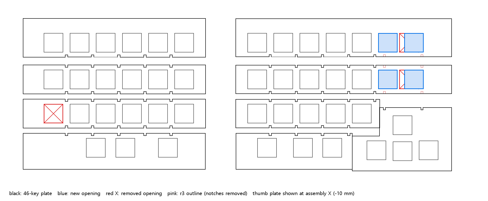
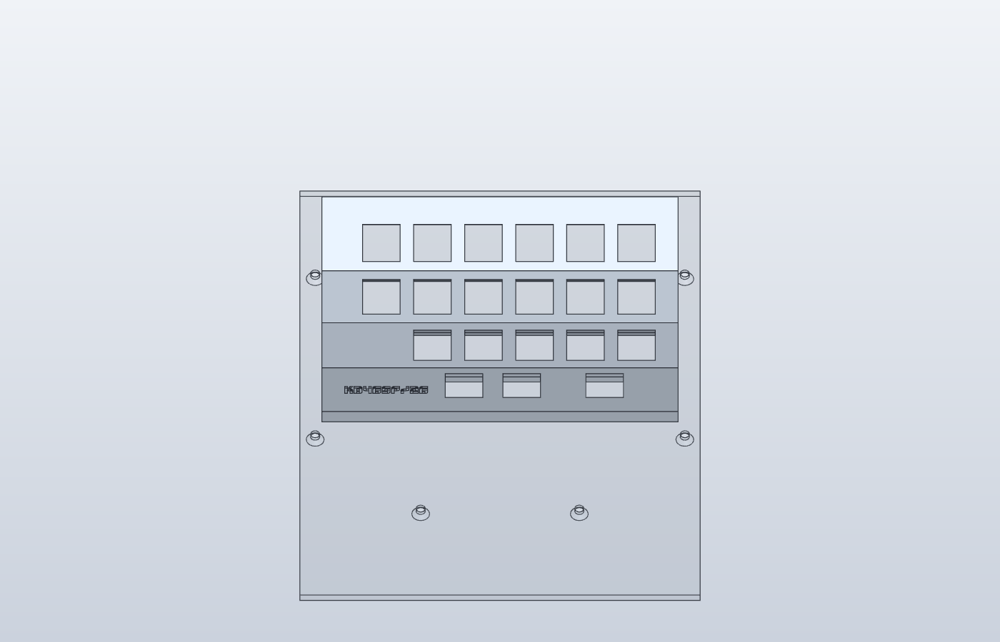
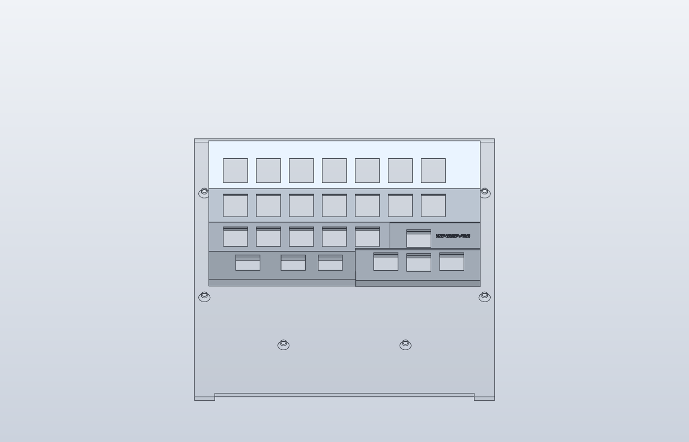
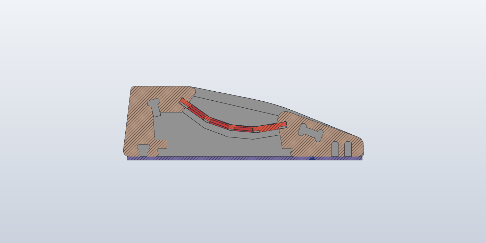
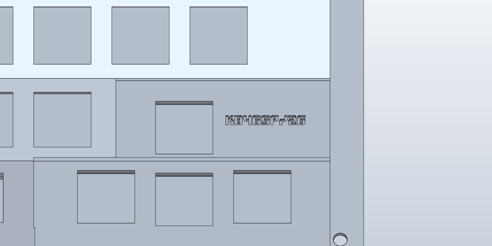
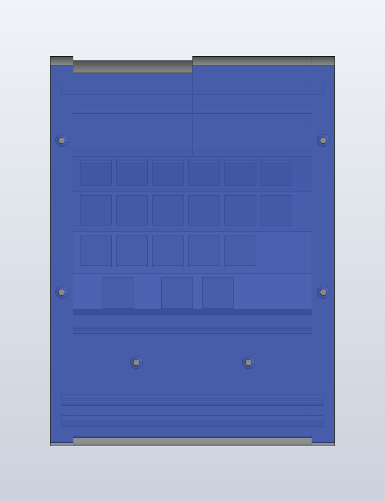

# 46sp

46sp는 기존 레이저 절단 합판 케이스, 아크릴 플레이트, 키스위치까지 조립된 좌우 분리형 키보드다. 내부 구조 설계가 해결되지 않아 작업이 멈췄으며, 이를 해결하기 위해 3D 프린팅 구조로 전환한다. 기존 조립체와 r3 도면을 키 배열·높이·각도의 참고로 삼아 SolidCraft에서 케이스·플레이트·내부 지지·체결·배선 공간을 함께 설계한다. r3 도면의 개구는 왼쪽 21개, 오른쪽 24개이며, 출력 설계와 펌웨어는 **46키**를 기준으로 한다.

남은 작업의 진행 순서와 단계별 완료 기준은 [남은 작업](TODO.md)에, 출력 부품의 조립·배선·플래시 순서는 [조립 가이드](ASSEMBLY.md)에 정리한다.

## 키 배열: 46키

2026-11-12 사용자 결정으로 46키를 기준으로 진행한다. 물리 배열은 46es와 같다. 오른쪽 폭은 사용자가 실물 케이스를 보고 다시 검토한다.

```
왼쪽 (6·6·5 + 엄지 3 = 20)          오른쪽 (7·7·5 + 엄지 3 + 크로스 4 = 26)
1행  Esc  Q    W    E  R  T          Y  U  I  O  P  Bspc  PgUp
2행  Tab  A    S    D  F  G          H  J  K  L  ;  '     PgDn
3행       Z/Sft X/Alt C V  B          N  M  ,  .  //Sft
엄지      LCtl  LGui  Spc/NUM        Spc/SYM  RAlt  FN
                                     크로스: ←  ↑  ↓  →
```

| 출처 | 왼쪽 | 오른쪽 | 합계 |
|---|---|---|---:|
| r3 판(`46sp_plate_r3.dwg`, 검정아스텔 5T) | 6·6·6·3 = 21 | 6·6·5·3·4 = 24 | 45 |
| `46sp_keyboard.dwg` 조립도의 판 | 6·6·5·3 = 20 | 6·6·5·3·4 = 24 | 44 |
| **출력 설계·펌웨어** | **6·6·5·3 = 20** | **7·7·5·3·4 = 26** | **46** |

- 왼쪽 3행에는 바깥 열 키가 없다. r3 판에 있는 이 개구는 출력 설계에 넣지 않는다.
- 오른쪽 1·2행은 r3 판보다 한 키씩 많다. case 폭은 그대로 두고 plate만 바꿔 넣는다(사용자 결정 2026-11-13). 아래 [46키 plate](#46키-plate-기존-case-재사용)를 본다.
- 46es 펌웨어의 키맵 행은 배선 행(4 × 12)이라 물리 행과 다르다. 46sp 펌웨어는 물리 행으로 정의한다.
- [r3 모델](model/r3-plates.sc)과 [스위치 좌표](model/r3-switches.json)는 기존 가공 부품의 45개 개구 기록으로 그대로 둔다.

## 46키 plate (기존 case 재사용)

기조립된 합판 case와 아크릴 측판(cheek)을 그대로 두고 plate만 다시 만든다. 2026-11-13부터 plate는 출력한다([출력 plate와 bottom cover](#출력-plate와-bottom-cover-기존-case-재사용)). 이 DXF는 그 키 위치의 기준이다. [tools/plate_46key.py](tools/plate_46key.py)가 r3 도면(`source/46sp_plate_r3.converted.dxf`)을 고쳐 [46sp_plate_46key.dxf](source/46sp_plate_46key.dxf)와 [46key-switches.json](model/46key-switches.json)을 쓰고 검사한다. 판 외곽 길이와 행 모양은 r3와 같아서 기존 측판 홈에 그대로 들어간다.

```powershell
python 46sp/tools/plate_46key.py
& 'C:\Program Files\ArtCraft\CADCraft\cadcraft-cli.exe' convert 46sp/source/46sp_plate_46key.dxf 46sp/source/46sp_plate_46key.dwg
python 46sp/tools/render_plate_46key.py 46sp/source/46sp_plate_r3.converted.dxf 46sp/source/46sp_plate_46key.dxf 46sp/images/plate-46key.png
```



| 판 | r3 → 46키 | 바뀐 것 |
|---|---|---|
| `L_R2` | 6 → 5 | 바깥 구멍(X 37.225)을 뺀다 |
| `R_R0`·`R_R1` | 6 → 7 | 6번 구멍(X 296.09)을 빼고, 5번(261.725) 뒤에 19.05 간격으로 280.775·299.825를 낸다. 이 두 구멍 밑을 지나던 리브 홈(X 278.25·305.62) 두 개씩을 없앤다 |
| 나머지 6장 | 그대로 | — |

- 폭 검사(측판 두께 4 mm, `46sp_r3_left.step`의 keypad_side 값): 오른쪽 7번 키캡(18.2 mm) 끝에서 측판 안쪽 면까지 14.1 mm가 남는다. 안쪽 끝은 r3와 같은 2.4 mm다. 바꾼 3장의 구멍 사이 살은 5.05, 구멍–판 끝 살은 2.46 mm이고, 남은 리브 홈은 이어지는 행의 구멍과 X로 1.67 mm 이상 떨어져 있다.
- 오른쪽 6·7번 대안이 없었던 이유: r3의 6번(296.09)을 두고 7번을 바깥에 더하면 키캡이 측판에 닿는다(315.14 + 9.1 > 323). 통로 안쪽(277)에 더하면 5번과 15.3 mm 간격이 되어 키캡이 겹친다.
- **엄지(십자) 판 `178A`는 도면에서 10 mm 오른쪽에 그려져 있다.** 조립 위치는 X 255–327이다. 판 끝이 R3 끝(255), R2 끝(274.75), R0·R1 끝(327)과 맞고, 뒤 가장자리 리브 홈(도면 288.25·315.62)이 R0·R1 홈(278.25·305.62)과 10 mm씩 차이 난다. 조립 X로 십자 키는 ← 272.4, ↑·↓ 291.4, → 310.5이고, ↑은 새 PgUp·PgDn 두 열(280.8·299.8) 사이에 놓인다(6번 열에서 +10.7, 7번 열에서 −8.4). `46key-switches.json`의 `x_assembly_mm`가 이 값이다. 출력 모델(`build_print.py`)은 도면 X를 그대로 썼다.
- **리브는 쓰지 않는다(사용자 2026-11-13).** 리브는 행마다 따로 자른 아크릴 판을 잇고 받치던 부품이다. 새 plate는 반쪽마다 한 덩어리로 출력하므로 필요 없다. 어림으로 오른쪽 경간 149 mm 가운데를 10 N으로 눌러도 처짐은 0.1 mm 안팎이다(PA12 E 1.7 GPa, 구멍 줄 단면). 도면의 리브 홈과 리브 윤곽은 r3 기록으로 남아 있다.
- **아크릴 측판(cheek) 재사용**: 측판 4장의 홈은 모두 폭 5.5 mm(5 mm 판 + 0.25 mm 양쪽)이고, 모양은 46키 plate의 행 단면과 같다. 왼쪽 두 장과 오른쪽 안쪽 측판(22B8)은 4행(+22.5° / +6.07° / −8.19° / −22.5°)을 잡는다. 오른쪽 바깥 측판(22B6)은 R0·R1과 엄지 판의 15° 평면(길이 46.6)을 잡는다. 그래서 출력 plate 끝 4 mm를 r3 단면(두께 5.0)으로 만들면 기존 측판에 그대로 끼워진다. 다만 측판 홈은 막힌 창이라 plate 끝을 X 방향으로 밀어 넣어야 한다. 이미 측벽에 들어가 있는 측판을 쓰려면 측벽을 열 수 있어야 한다.
- 확인하지 못한 것: 실물 측판 두께와 판–홈 여유(STEP의 판 폭은 134, r3 도면은 133), R1 6·7번 스위치 몸체와 엄지 판 사이의 상하 간격(단면 검토 필요), 바뀐 판 3장을 r3와 같은 5T 검정 아스텔로 다시 가공할지.

## 출력 plate와 bottom cover (기존 case 재사용)

2026-11-13 결정: 합판 case(CNC 적층, 측벽은 끼움 결합이고 작업이 끝나면 목공풀로 고정)와 아크릴 측판은 그대로 쓴다. 출력(MJF)하는 것은 반쪽마다 **plate**와 **bottom cover** 두 부품이다. 리브는 쓰지 않는다. [46sp-plate-cover.sc](model/46sp-plate-cover.sc)와 출력 파일 [model/print/](model/print/)(`46sp_Plate_L/R.stl`, `46sp_Cover_L/R.stl`, 조립 좌표 STEP)은 [tools/build_plate_cover.py](tools/build_plate_cover.py)가 만든다.

```powershell
python 46sp/tools/build_plate_cover.py --check-case   # 약 15초. --font <Xifiction.ttf>는 로고 글자 윤곽을 다시 뽑는다
```

| 왼쪽 | 오른쪽 |
|---|---|
|  |  |



| 부품 | 형상 |
|---|---|
| plate (`Plate_L` 133 · `Plate_R` 157 mm) | 단면은 r3 측판 홈(왼쪽과 오른쪽 안쪽은 `22A0`, 오른쪽 바깥은 `22CB`)을 사방 0.25 mm 줄인 두께 5.0 띠다. 양 끝이 그대로 측판 홈(5.5)에 들어간다. 오른쪽은 X 구간마다 단면이 다르다: R3 끝(도면 255)까지는 4행, R2 끝(274.75)까지는 R1–R3와 엄지 평면 아랫부분, 그 바깥은 R1·R2와 15° 엄지 평면 전체다. 스위치 구멍 14.0, 윗면 걸쇠 층 1.5, 아래 릴리프 16.5(46es 값). 키 위치는 [46key-switches.json](model/46key-switches.json)이다 |
| 로고 | 46es와 같은 Xifiction 폰트로 `kb46sp/26`을 왼쪽 엄지 행 바깥 빈자리(키를 뺀 3행 바깥 아래)에 음각한다. 높이 4.0, 폭 31.0, 획 1.0, 글자 사이 살 0.5, 깊이 0.8. 키보드 앞에서 바로 읽힌다  |
| bottom cover (`Cover_L` 149.4 · `Cover_R` 173.4 mm) | 3 mm 평판을 case 바닥(Z 0) 밑에 댄다. 외곽은 STEP에서 잰 바닥면 발자국을 따른다: 측벽과 뒤 블록 바깥 절반은 Y 5.25–204.25, 앞 블록은 201.5까지다. 왼쪽 cover만 뒤 블록 안쪽 절반(−X)에서 9.4부터 시작한다. 그 자리는 USB 출구가 있는 왼쪽 case에만 있다고 보았다(오른쪽 실물에서 확인)  목재 나사 3 mm 접시머리 6개(Ø3.4, 접시 Ø6.6 · 90°): 측벽 X ±69(오른쪽 ±81)의 Y 45·125, 앞 블록의 Y 162. bone 막대 홈은 피했다. 측벽을 목공풀로 고정하면 배선과 컨트롤러를 정비할 길은 cover뿐이라, cover는 나사로 푼다 |

- 좌표는 `46sp_r3_left.step`의 것이다: Y는 앞(0 = 뒷면), Z는 위(0 = case 바닥), X는 사용자 왼쪽이 +X다. 도면에서 옮길 때 측판 단면은 −13° 돌리고 (9.72, −26.19)만큼 옮긴다. STEP 측판 외곽이 r3 `229E`와 맞고, STEP의 아크릴 판 세 장이 이 홈 안에 모두 들어간다. X는 도면을 Z축으로 180° 돌린 값(`mid − x`)이다.
- 생성기 검사: 부품 4개가 닫힌 솔리드인지와 부피가 계산값과 맞는지 본다. plate는 단면 넓이 × 길이에서 구멍·릴리프·로고를 빼고, cover는 판에서 나사 구멍을 뺀 값이다. 그 밖에 키캡–측판 1 mm, 릴리프–행 끝 1.5 mm, 로고–릴리프 1.5 mm, 나사–bone 홈 간격을 검사한다. `--check-case`는 왼쪽 plate·cover를 STEP case와 간섭 검사한다. 합판 측벽, 앞뒤 블록과는 겹치지 않는다.
- **측판 홈이 두 가지다.** STEP(f3d)의 측판 홈은 폭 약 3.5, 끝이 둥글고, 행 길이가 26.86 / 19.05 / 19.05 / 26.86이다. r3 DWG 측판 홈(`22A0`)은 폭 5.5, 행 28.05 / 20.9 / 20.9 / 26.05다. 외곽은 같다. 출력 plate는 r3 DWG(5T 아스텔 판의 가공 도면)를 따랐다. 그래서 `--check-case`에서 plate 끝 혀가 STEP 측판과 양쪽 560 mm³씩 겹친다. 실물 아크릴 판 두께(5 또는 약 3.5)와 1·2행 판 폭(20.9 또는 19.05)을 재면 어느 쪽인지 정해진다.
- 오른쪽 case는 왼쪽과 같은 구조이고 폭이 조금 크다. AUX 구멍은 왼쪽 면(안쪽 측벽)에 있고 뒷면 USB 출구는 없다. 왼쪽 case는 뒷면에 USB 출구, 오른쪽 면(안쪽 측벽)에 AUX 구멍이 있다(사용자 2026-11-13). STEP에는 두 구멍이 모델링돼 있지 않다. 오른쪽은 왼쪽 단면·바닥 홈·나사 배치를 그대로 쓰고, 안쪽 폭 158은 오른쪽 r3 판(157)과 bone 막대 길이에서 잡았다(바깥 174, 왼쪽 150).
- 확인하지 못한 것: MJF 음각 최소 치수(업체 기준), 실물 측판 홈 폭과 plate 끝 혀의 끼움(MJF 공차), 오른쪽 case 실측, 스위치 몸체와 R1–엄지 판 사이의 상하 간격, 고무발 자리, 컨트롤러 고정 위치, AUX 구멍과 USB 출구의 실제 위치(STEP에는 없다. 왼쪽 뒤 블록 안쪽 절반의 뒷면이 2.3 mm 들어가 있는데, 사용자는 컨트롤러 자리로 본다), 오른쪽 뒤 블록에 같은 들어감이 있는지.

## 출력 모델 (MJF, 폐기)

> **폐기(2026-11-13)**: 위의 [출력 plate와 bottom cover](#출력-plate와-bottom-cover-기존-case-재사용)가 대체한다. 아래는 case까지 새로 출력하는 방향으로 만든 것이다(2026-11-12). 기록으로 남긴다. 컨트롤러 받침도 RP2040-Zero 치수(23.5 × 18)로 남아 있다. 기존 case의 3D 형상은 f3d에서 내보낸 STEP으로 받는다.

2026-11-12 결정: 출력은 46es처럼 외주 MJF(검정), 좌우 연결은 보유 AUX(3.5 mm 잭과 케이블)를 쓴다. 반쪽마다 **plate**와 **case** 두 부품이다. [46sp-print.sc](model/46sp-print.sc)는 [tools/build_print.py](tools/build_print.py)가 r3 DXF에서 만든다.

```powershell
python 46sp/tools/build_print.py    # 약 2분, 46sp/model/46sp-print.sc를 다시 쓴다
```

| 부품 | 형상 |
|---|---|
| plate (`Plate_L`·`Plate_R`) | 4행을 r3 측판 홈(`22A0`)의 단면 그대로 이은 5 mm 굽은 판. 행 기울기 +22.5° / +6.07° / −8.19° / −22.5°(+는 뒤가 높음), 이웃 행은 밑면 선이 만나는 곳에서 잇는다. 스위치 구멍 14.0, 윗면 걸쇠 층 1.5, 아래 릴리프 16.5(46es 값). 밑에 세로 다리 Ø7.5가 6개씩 있고 다리 끝(Z 4.2)에 보유 원형 인서트 Ø5 × 4를 넣는다(구멍 Ø4.2 × 5, 위로 Ø3.0 × 4) |
| case (`Case_L`·`Case_R`) | 벽 2·바닥 2 트레이. 벽 윗면이 plate 밑면 곡선을 따라 plate를 받친다. 다리 밑 바닥 패드 Ø11(Z 0–4)에 밑에서 보유 흑색 M3×10을 넣는다(카운터보어 Ø6.4 × 2, 구멍 Ø3.4). RP2040-Zero 받침(23.5 × 18 + 여유 0.2, 벽 1.2 × 높이 2)과 뒤 벽 USB-C 개구 11 × 6.5, 안쪽 벽 AUX 잭 구멍 Ø6.2(뒤에서 6.5, 바닥 위 5.5) |

- 좌표: X는 r3 도면 X(왼쪽 15–148, 오른쪽 170–337), Y는 뒤쪽, Z = 0은 바닥 밑면. 키 X와 행 안 위치는 r3 판 구멍에서 읽는다.
- 46키 변경: 왼쪽 3행 바깥 키를 뺀다. 오른쪽 1·2행은 r3의 5키 뒤에 1u 간격으로 두 키를 이어 7키로 만든다(마지막 키 X 299.8, 판 끝 337). r3의 따로 기울어진 십자 판(15°) 대신, 십자 위 키는 3행에, 왼·아래·오른 키는 4행에 같은 X로 놓았다.
- 가정: 키보드 전체 기울기 `TILT_DEG` 0°(r3 측판 윗변 수평), plate 밑면 최저점 Z 10(스위치 핀 3.3 + 다이오드·배선 3 + 바닥 2 여유). 이 경우 판 앞뒤 끝 윗면이 Z 28.8이다. 실물 조립체의 높이·기울기를 재면 이 두 값을 바꾼다.
- 다리는 X 방향 옆에 스위치가 없는 자리에만 둔다(바깥 여백, 왼쪽 3행 빈 바깥, 엄지 행 빈칸). 1–3행 안쪽 끝(왼쪽 X 139.5–146, 오른쪽 172–178.5)은 6.5 mm라 다리가 들어가지 않아, 뒤 안쪽 모서리는 벽이 받치기만 한다. 인서트는 12개를 쓰고 2개가 남는다.
- 생성기 검사: 부품 4개가 닫힌 솔리드인지, plate 부피가 계산값(판 단면 × 폭 − 구멍·릴리프 + 다리 − 인서트 구멍)과 0.02 % 안에서 맞는지, 스위치 여유(구멍 윤곽을 판 윗면에서 11.3 아래까지)가 바닥·다리·릴리프·컨트롤러·잭과 겹치지 않는지 본다.
- 확인하지 못한 것: 실물 끼움(스위치 구멍·인서트 구멍은 46es 쿠폰 결과를 따른다), AUX 잭과 RP2040-Zero 실물 치수, USB 플러그 몸체 크기, 오목한 행에서 키캡끼리의 간격(r3와 같은 행 배치라 같다고 본다), MJF 휨.

## 원본과 SolidCraft 모델

아래 r3 복원 모델은 기존 가공 부품의 형상 참고 자료이고, 출력 모델의 행 단면과 키 위치를 여기서 읽는다. 리브 받침과 Pro Micro 받침은 기존 합판·아크릴 활용을 전제로 만든 초기 시제품이다.

[Drive 원본](https://drive.google.com/drive/folders/1DNMSNlSEzdR8m5Bf25lDaad6fUhWz5xY) ZIP의 `keyboard/kb46sp/`에서 DWG, Fusion, DXF를 [source/](source/)에 옮겼다. `46sp_plate_r3.converted.dxf`는 CADCraft로 r3 DWG를 변환한 파일이다. `dxf/46sp_side.dxf`에는 합판 측판의 외곽과 개구, `dxf/46sp_inside_*.dxf`에는 안쪽 부품의 가공 윤곽이 있다. `46sp_r3_left.f3d`는 왼쪽 설계 참고용으로 보관한다.

f3d는 Fusion에서 STEP으로 내보냈다(2026-11-12, `source/*.step`). 모두 **왼쪽 반쪽**의 부피 모델이고 스위치 구멍과 리브는 없다. 키 배열은 r3 도면에서 읽는다.

| STEP | 내용 |
|---|---|
| `46sp_r3_left.step` | 조립된 case의 왼쪽: 합판 측벽 `side_l/r`(X ±63–75, 바깥 폭 150), 아크릴 측판 `keypad_side_l/r`(4 mm), 안쪽 합판 블록 `inside_fw`·`inside_bw_a/b`, 4행 plate `keypad`(판 폭 134). 측판 외곽은 r3 `229E`와 면적·모양이 같고(대칭 차 0) 13° 돌아가 놓여 있다. 측벽은 `dxf/46sp_side.dxf`(205.35 × 60)와 같다 |
| `46sp_r2_left.step`, `46sp_v18.step` | 이전 리비전(r2, v18의 `bone` 포함) |
| `kb46sp_r1.step`, `kb46sp_v11.step` | 첫 리비전의 한 덩어리 외형 |
| `46sp_r3_v13.step` | 형상이 없다(헤더만). 양쪽 전체가 필요하면 Fusion에서 다시 내보낸다 |

| 파일 | 내용 |
|---|---|
| [r3-plates.sc](model/r3-plates.sc) | 좌우 플레이트 9개. 탭 홈과 45개 스위치 개구 보존. `plate_t` 기본값 5 mm |
| [r3-supports.sc](model/r3-supports.sc) | 리브 11개, 창이 있는 옆 지지판 4개. `rib_t` 기본값 1.5 mm, `cheek_t` 기본값 5 mm |
| [r3-switches.json](model/r3-switches.json) | 플레이트별 스위치 개구 중심과 DXF 핸들. 좌표는 가공 전개도 기준 |
| [r3-rib-saddle.sc](model/r3-rib-saddle.sc) | r3 짧은 리브 하단에 맞춘 합판 고정 받침 시제품 |
| [pro-micro-carrier.sc](model/pro-micro-carrier.sc) | 초기 Pro Micro 받침 시제품. 출력 장착부 설계 참고 |
| [switch-fit.sc](model/switch-fit.sc) | 1.5 mm 시험편. −X부터 13.9, 14.0, 14.1 mm 정사각 개구 |

r3 주석의 5T 검정 아스텔과 1.5T 투명 압출판을 각 그룹의 모델 두께로 적용했다. 옆 지지판도 5 mm로 가정했다. SolidCraft의 플레이트와 지지 부품은 가공 전개 좌표에 놓여 있다. 아크릴 현물의 두께와 조립 후 행별 각도·높이는 대조가 필요하다.

재생성에는 Python의 `ezdxf`, `shapely`와 SolidCraft CLI가 필요하다. r3 DXF 윤곽을 그대로 넣고 몸체별 폐합 여부 및 순면적 × 두께를 검사한다. 끝점이 일치하는 178A와 옆 지지판 개구의 폴리라인은 닫힌 윤곽으로 읽는다.

```powershell
python 46sp/build_r3.py --cli 'C:\Program Files\SolidCraft\solidcraft-cli.exe'
```

## 기존 받침 시제품 참고

받침 시제품은 r3 DXF의 짧은 리브(2723) 하단 꺾임을 기준으로 했다. 18 × 17 × 6 mm 베이스에 리브 두께 1.5 mm와 양쪽 0.15 mm 여유를 합친 1.8 mm 홈을 냈다. 홈 바닥은 중앙에서 높이 2.4 mm이며 리브의 양쪽 경사를 따라 올라간다. 합판 체결용 Ø3.4 mm 구멍 두 개의 간격은 11 mm다. 이 치수와 M3 관통 체결은 초기 받침 시제품에 해당한다. 출력 구조의 지지 방식과 패스너는 새 조립 모델에서 결정한다.

컨트롤러 받침은 46es의 33 × 18 mm Pro Micro 외곽을 기준으로 했다. 베이스는 47 × 24 × 5.4 mm이고, M3 여유홀은 Ø3.4 mm, 간격 40 mm다. 보드는 부품면이 위로 향하게 중앙 10 mm 폭 절연 양면테이프 위에 놓는다. 양쪽 패드 아래로 3 mm 공간을 확보했다. 설치할 때 양면테이프 두께, 납땜 돌출, 부품면 높이, USB 플러그와 나사머리의 간섭을 확인한다. USB 꽂고 빼는 힘은 케이스에 고정한 패널 연장선과 케이블 고정부가 받도록 한다.

기존 검토에서는 46es 방식의 16.5 mm 전면적 하면 릴리프를 r3 윤곽에 적용하면 일부 행의 외곽이나 홈까지 약 0.55–0.69 mm만 남았다. 출력 플레이트를 설계할 때 개구 주변 벽 두께와 걸쇠 공간을 함께 검토한다.

## 좌우 연결과 펌웨어

**ATmega32U4 Pro Micro 두 개**(보유 USB-C 보드, 5 V)를 사용한다(사용자 정정 2026-11-12, 2026-11-11의 RP2040-Zero 전환을 되돌림). PC는 데이터 전송이 가능한 USB 케이블로 왼쪽 보드의 USB-C에 연결한다. 오른쪽은 왼쪽에서 5 V 전원을 받고, 키 입력은 `D2` 단선으로 **QMK AVR bitbang 시리얼**을 통해 왼쪽에 전달한다. 4행 × 7열을 각 반쪽에서 스캔하므로 좌우 사이에는 전원, 접지, 데이터 세 가닥이면 된다. [QMK Split Keyboard](https://docs.qmk.fm/features/split_keyboard) · [QMK 시리얼](https://docs.qmk.fm/drivers/serial)

보유 AUX 3.5 mm 잭을 두 케이스에 고정하고 케이블로 1↔1, 2↔2, 3↔3을 잇는다. 아래 번호는 배선 규약이다. 잭의 팁·링·슬리브와 번호의 대응은 실물 잭과 케이블의 연속성을 재서 정한다. 보드의 핀 라벨을 확인하고, 전원 공급 전에 케이블의 연속성과 5 V–GND 단락 여부를 확인한다. 좌우 케이블은 USB 전원을 뺀 상태에서 탈착한다.

| 연결 핀 | 왼쪽 | 오른쪽 |
|---|---|---|
| 1 | GND | GND |
| 2 | VCC (5 V) | VCC (5 V) |
| 3 | D2 (RXI) | D2 (RXI) |

| 매트릭스 | AVR 핀 순서 (좌우 동일) | Pro Micro 인쇄 라벨 |
|---|---|---|
| R0–R3 | D1, D0, D4, C6 | 2, 3, 4, 5 |
| C0–C6 | D7, E6, B4, B5, F4, F5, F6 | 6, 7, 8, 9, A3, A2, A1 |

다이오드는 `COL2ROW`로 배선한다. 열 → 스위치 → 다이오드 → 행 순서이며 다이오드 띠가 행을 향한다. 행은 뒤에서 앞으로 R0–R3, 열은 같은 세로 열의 키가 같은 열 선을 쓰도록 지정한다. 왼쪽은 바깥 열이 C0이고(R0·R1은 C0–C5, 바깥 키가 없는 R2는 C1–C5, 엄지는 C0–C2), 오른쪽은 안쪽 열이 C0이다(R0·R1은 C0–C6, R2는 C0–C4, 엄지는 C0–C2). 오른쪽 네 키 크로스의 왼쪽·위·아래·오른쪽을 R3의 C3–C6에 붙인다. [keyboard.json](firmware/46sp/keyboard.json)의 오른쪽 행 4–7은 QMK가 두 반쪽의 행을 합친 번호다.

QMK Firmware 체크아웃의 `keyboards/46sp/`로 [firmware/46sp/](firmware/46sp/)를 복사하고 `qmk compile -kb 46sp -km default`를 실행한다. 좌우 케이블을 분리한 상태에서 보드 하나만 USB로 연결하고 `qmk flash -kb 46sp -km default`를 실행한 뒤, 기다리라는 표시가 나오면 RST 핀을 GND에 짧게 대어(Caterina 부트로더, 약 8초 대기) 같은 빌드를 기록한다. 다른 쪽도 같은 방법으로 기록한다. 좌우의 5 V 핀이 이어지므로 플래시 중에는 보드 하나만 PC에 연결한다. 케이스에서 왼쪽 USB-C에 평소 접근할 수 있게 하고, 양쪽의 USB-C와 RST 핀에 정비 시 접근할 수 있게 한다. FN 레이어의 `QK_BOOT`(Y 자리)는 USB를 꽂은 왼쪽 보드를 부트로더로 보낸다. [QMK 플래시](https://docs.qmk.fm/newbs_flashing)

기본 키맵은 [46es 펌웨어](../46es/firmware/46es_kbfirmware.json)의 BASE·NUM·SYM·FN 네 레이어를 물리 위치 그대로 옮겼다. 46es의 `RESET`은 `QK_BOOT`(FN 레이어의 Y 자리), `LSFT(LGUI(KC_S))`는 `LSG(KC_S)`로 썼다. 첫 하드웨어 시험은 왼쪽 단독 입력, USB를 뺀 뒤 좌우 케이블 연결, 왼쪽 USB 재연결, 오른쪽 입력 및 양손 동시 입력 순서로 진행한다.

## 검증 상태

- 사용자 확인에 따라 기존 합판 케이스·아크릴 플레이트·키스위치의 조립은 완료된 상태다. 내부 구조 미설계로 중단된 작업을 3D 프린팅 전환으로 이어간다.
- CAD 재생성에서 플레이트 9개와 내부 지지 부품 15개가 각각 닫힌 솔리드이며 부피가 원본 윤곽과 일치했다. r3 2723 리브와 받침의 겹침은 SolidCraft에서 0 mm³였다.
- 45키 펌웨어는 ATmega32U4/Caterina(QMK `d194c077ed`)와 RP2040(QMK `d194c077ed964195ec16d255c7a4b89a794cf03b`, QMK CLI 1.2.0, Arm GCC 13.2.1)으로 각각 빌드한 적이 있다. 2026-11-12에 같은 ATmega32U4 핀 배정으로 되돌렸다. 시리얼을 포함한 핀 12개는 중복이 없다.
- 46키로 바꾼 뒤(2026-11-12) 스크립트로 46개 매트릭스 위치가 겹치지 않는 것과, 네 레이어의 46키가 46es 키맵과 물리 위치별로 모두 같은 것을 확인했다. 이 PC에는 QMK가 없어 46키 펌웨어는 아직 컴파일하지 않았다. 실제 보드의 플래시와 좌우 입력 시험도 남아 있다.
- 출력 모델 [46sp-print.sc](model/46sp-print.sc)(2026-11-12): 부품 4개 닫힘, plate 부피가 계산값과 0.01 % 안(왼쪽 44144.0 / 44143.8, 오른쪽 53462.3 / 53462.0 mm³), 스위치 여유 간섭 없음. 출력 공차 시험, 실물 치수 대조, 기존 스위치 이식, 배선·펌웨어 실기 시험이 남아 있다.
